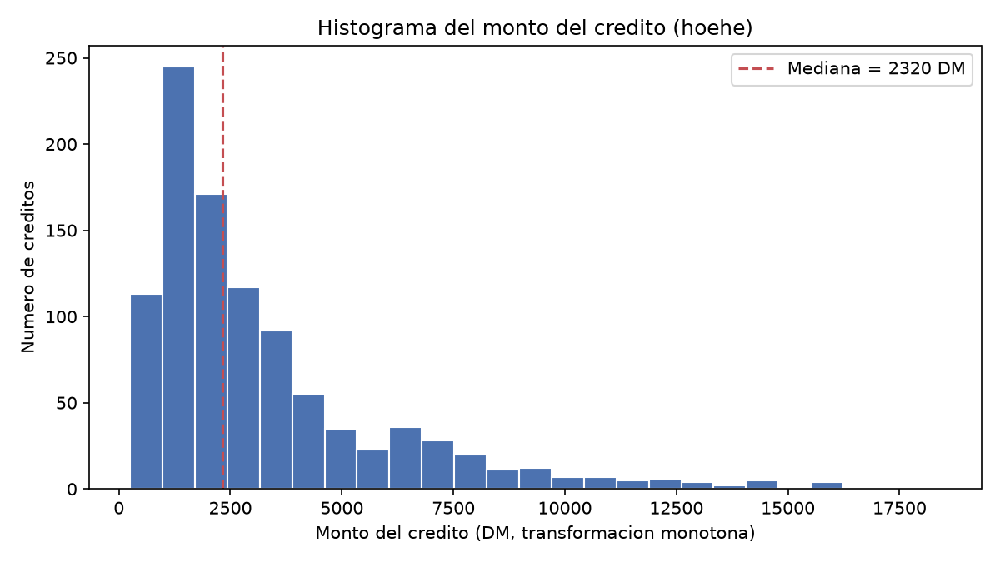
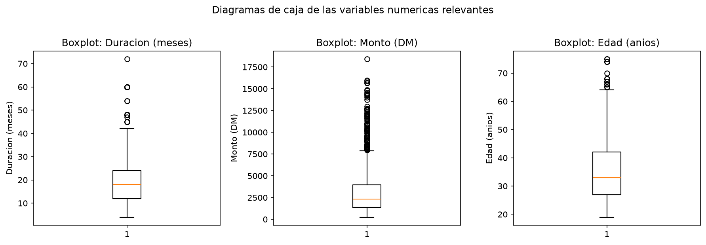
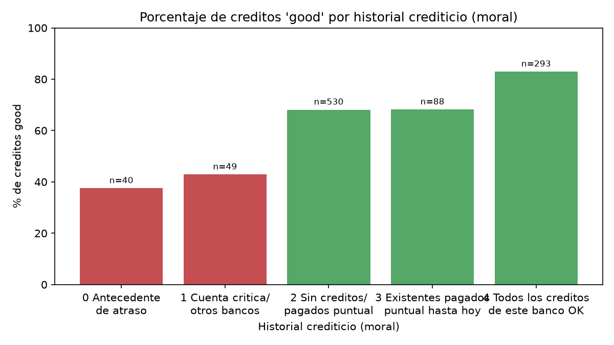
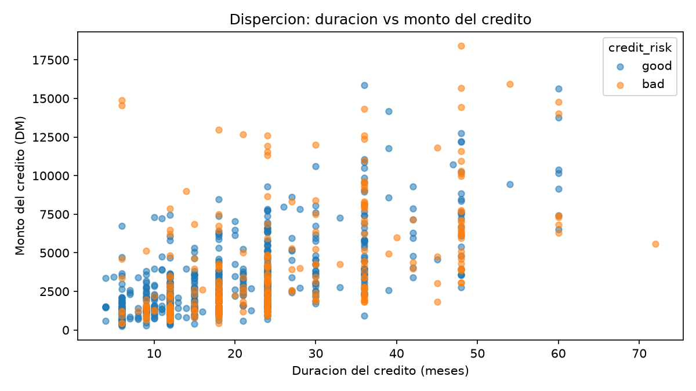
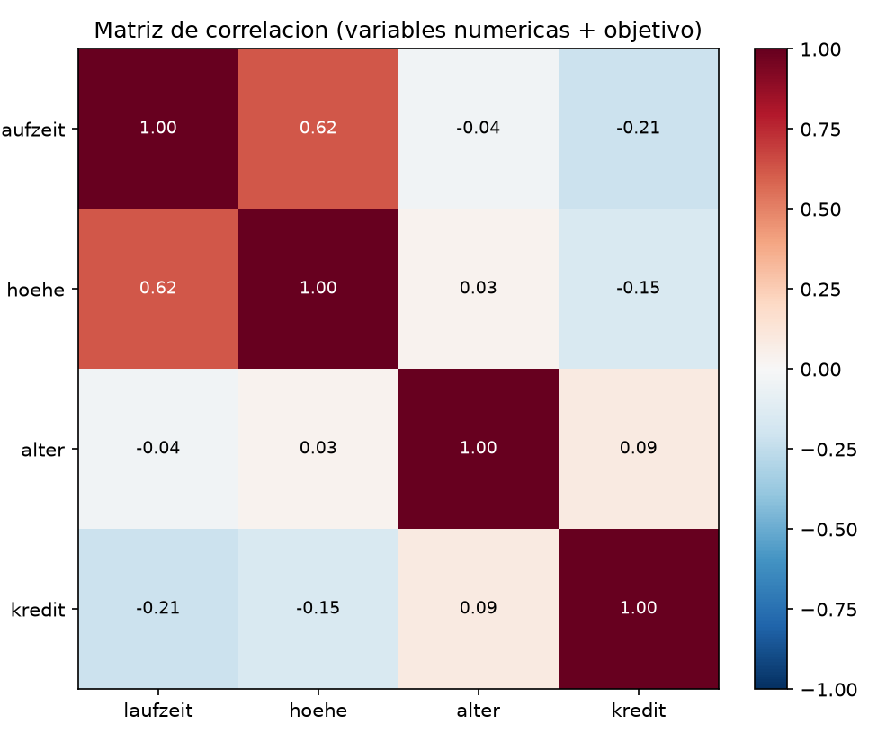

# Código fuente de las figuras — Exploración técnica

**Proyecto:** Análisis de riesgo crediticio · South German Credit (UCI, id 573)
**Unidad II:** Diagnóstico del conjunto de datos del Proyecto Integrador
**Alumno:** Alexander Domínguez Zárate · Matrícula 23301324 · Universidad Tecnológica de Tula-Tepeji (UTTT)
**Fecha de documentación:** 2026-11-09
**Fuente canónica del código:** `src/preprocessing/figuras_fuente.py`
**Destino de las figuras:** `docs/analisis/figuras/` (fig1–fig5, PNG)

---

## Cómo regenerar las figuras

```bash
py src/preprocessing/figuras_fuente.py              # figuras oficiales
py src/preprocessing/figuras_fuente.py <carpeta>    # carpeta alternativa (no toca las oficiales)
```

El script es **autosuficiente**: lee el CSV crudo una sola vez (`sep=" "`), y cada figura vive en su propia función. Las figuras se generan con el backend no interactivo `Agg`, por lo que funciona igual en terminal, notebook o CI.

---

## Mapa de figuras

| Figura | Archivo PNG | Sección del informe | Variables | Tipo de gráfica |
|---|---|---|---|---|
| Fig. 1 | `fig1_hist_monto.png` | 8.1 | `hoehe` | Histograma |
| Fig. 2 | `fig2_boxplot_numericas.png` | 7 | `laufzeit`, `hoehe`, `alter` | Boxplots (1×3) |
| Fig. 3 | `fig3_barras_riesgo_historial.png` | 8.2 | `moral`, `kredit` | Barras con anotaciones |
| Fig. 4 | `fig4_dispersion_monto_plazo.png` | 8.3 | `laufzeit`, `hoehe`, `kredit` | Dispersión por clase |
| Fig. 5 | `fig5_correlacion.png` | 8.4 | `laufzeit`, `hoehe`, `alter`, `kredit` | Matriz de calor |

**Convención de lectura:** el flujo es `CSV → Pandas (carga, filtrar, agrupar, calcular) → Matplotlib (dibujar) → PNG`. Pandas *nunca dibuja*; los comentarios `# TRASPASO Pandas -> Matplotlib #n` del script marcan el punto exacto donde un objeto de Pandas se entrega a Matplotlib.

---

## Fig. 1 — Histograma del monto del crédito

### Código fuente (función `fig_hist_monto`)

```python
def fig_hist_monto(df, outdir):
    """Fig. 1 - Histograma del monto del credito (hoehe)."""
    fig, ax = plt.subplots(figsize=(8, 4.5))
    # TRASPASO Pandas -> Matplotlib #1: Series df["hoehe"] -> ax.hist
    ax.hist(df["hoehe"], bins=25, color=AZUL, edgecolor="white")
    # TRASPASO Pandas -> Matplotlib #2: escalar median() -> ax.axvline
    ax.axvline(df["hoehe"].median(), color=ROJO, linestyle="--",
               label=f"Mediana = {df['hoehe'].median():.0f} DM")
    ax.set_title("Histograma del monto del credito (hoehe)")
    ax.set_xlabel("Monto del credito (DM, transformacion monotona)")
    ax.set_ylabel("Numero de creditos")
    ax.legend()
    fig.tight_layout()
    destino = os.path.join(outdir, "fig1_hist_monto.png")
    fig.savefig(destino, dpi=150)
    plt.close(fig)
    return destino
```

### Lectura del código

- **Pandas** entrega dos cosas: la `Series` de 1000 montos (`df["hoehe"]`) para las 25 barras, y un escalar (`.median()` = 2 320 DM) para la línea de referencia roja.
- **Matplotlib** dibuja el histograma (`ax.hist`) y la línea vertical (`ax.axvline`); el resto son etiquetas y ajustes.
- El sesgo a la derecha del monto es visible: la mediana queda a la izquierda de la media (3 271 DM).

### Figura



### Ficha de preservación

| Campo | Valor |
|---|---|
| Archivo | `docs/analisis/figuras/fig1_hist_monto.png` |
| Tamaño | 37 979 bytes (≈ 37 KB) |
| Dimensiones | 1200 × 675 px (dpi = 150) |
| SHA-256 | `a3c4255f4734db609552dde8e9e1e10221a7b3b581b601d695e9b6e44ae2e00e` |

---

## Fig. 2 — Boxplots de las variables numéricas relevantes

### Código fuente (función `fig_boxplots`)

```python
def fig_boxplots(df, outdir):
    """Fig. 2 - Boxplots de las variables numericas relevantes."""
    fig, axes = plt.subplots(1, 3, figsize=(12, 4))
    for ax, col, titulo in zip(axes,
                               ["laufzeit", "hoehe", "alter"],
                               ["Duracion (meses)", "Monto (DM)", "Edad (anios)"]):
        # TRASPASO Pandas -> Matplotlib #3: Series df[col] -> ax.boxplot
        ax.boxplot(df[col], vert=True)
        ax.set_title(f"Boxplot: {titulo}")
        ax.set_ylabel(titulo)
    fig.suptitle("Diagramas de caja de las variables numericas relevantes", y=1.02)
    fig.tight_layout()
    destino = os.path.join(outdir, "fig2_boxplot_numericas.png")
    fig.savefig(destino, dpi=150, bbox_inches="tight")
    plt.close(fig)
    return destino
```

### Lectura del código

- **Pandas** solo entrega cada columna (`df[col]`); los cuartiles del boxplot los calcula **Matplotlib** internamente al dibujar.
- El bucle `zip` recorre las 3 variables: término equivale a figura × columna.
- Los outliers visibles ya se cuantificaron con la regla IQR en la sección 7 del informe (70 / 72 / 23 respectivamente).

### Figura



### Ficha de preservación

| Campo | Valor |
|---|---|
| Archivo | `docs/analisis/figuras/fig2_boxplot_numericas.png` |
| Tamaño | 61 337 bytes (≈ 60 KB) |
| Dimensiones | 1783 × 619 px (dpi = 150; recortada con `bbox_inches="tight"`) |
| SHA-256 | `40f7e8fa3d0e4dc2b4d6bf292a3c32f24233c1f1d46ad68c3986ad15d18cbe9a` |

---

## Fig. 3 — Barras: % de créditos `good` por historial crediticio

### Código fuente (función `fig_barras_historial`)

```python
def fig_barras_historial(df, outdir):
    """Fig. 3 - Porcentaje de creditos 'good' por historial crediticio (moral)."""
    # --- aqui Pandas calcula TODO; Matplotlib solo dibuja el resultado ---
    tasa = df.groupby("moral")["kredit"].mean() * 100      # % good por categoria
    conteo = df["moral"].value_counts().sort_index()       # n por categoria
    etiquetas = {
        0: "0 Antecedente\nde atraso",
        1: "1 Cuenta critica/\notros bancos",
        2: "2 Sin creditos/\npagados puntual",
        3: "3 Existentes pagados\npuntual hasta hoy",
        4: "4 Todos los creditos\nde este banco OK",
    }
    fig, ax = plt.subplots(figsize=(8, 4.5))
    # TRASPASO Pandas -> Matplotlib #4: tasa.index (etiquetas) + tasa.values (alturas)
    barras = ax.bar([etiquetas[i] for i in tasa.index], tasa.values,
                    color=[ROJO if v < 50 else VERDE for v in tasa.values])
    # TRASPASO Pandas -> Matplotlib #5: conteo.values -> anotaciones n=...
    for barra, n in zip(barras, conteo.values):
        ax.text(barra.get_x() + barra.get_width() / 2, barra.get_height() + 2,
                f"n={n}", ha="center", fontsize=8)
    ax.set_title("Porcentaje de creditos 'good' por historial crediticio (moral)")
    ax.set_xlabel("Historial crediticio (moral)")
    ax.set_ylabel("% de creditos good")
    ax.set_ylim(0, 100)
    fig.tight_layout()
    destino = os.path.join(outdir, "fig3_barras_riesgo_historial.png")
    fig.savefig(destino, dpi=150)
    plt.close(fig)
    return destino
```

### Lectura del código

- Aquí **Pandas hace el trabajo pesado**: `groupby("moral")["kredit"].mean() * 100` produce la `Series` `tasa` (porcentaje de `good` por categoría) y `value_counts().sort_index()` produce `conteo` (n por categoría, para anotar).
- **Matplotlib** dibuja las 5 barras con color condicional (rojo si < 50 % good) y anota `n=…` con las alturas ya calculadas.
- El traspaso usa `.index` (etiquetas categóricas traducidas por el diccionario `etiquetas`) y `.values` (alturas numéricas).

### Figura



### Ficha de preservación

| Campo | Valor |
|---|---|
| Archivo | `docs/analisis/figuras/fig3_barras_riesgo_historial.png` |
| Tamaño | 51 847 bytes (≈ 51 KB) |
| Dimensiones | 1200 × 675 px (dpi = 150) |
| SHA-256 | `db0ef47ca42d622a9415573db0028f5d33e68082819c66d133f2898c80934e04` |

---

## Fig. 4 — Dispersión: duración vs monto, coloreada por clase

### Código fuente (función `fig_dispersion`)

```python
def fig_dispersion(df, outdir):
    """Fig. 4 - Dispercion: duracion vs monto, coloreada por resultado."""
    # --- Pandas filtra las filas por clase (mascara booleana) ---
    good = df[df["kredit"] == 1]
    bad = df[df["kredit"] == 0]
    fig, ax = plt.subplots(figsize=(8, 4.5))
    # TRASPASO Pandas -> Matplotlib #6: 4 Series (x,y good + x,y bad) -> ax.scatter
    ax.scatter(good["laufzeit"], good["hoehe"], alpha=0.55, label="good", s=25)
    ax.scatter(bad["laufzeit"], bad["hoehe"], alpha=0.55, label="bad", s=25)
    ax.set_title("Dispercion: duracion vs monto del credito")
    ax.set_xlabel("Duracion del credito (meses)")
    ax.set_ylabel("Monto del credito (DM)")
    ax.legend(title="credit_risk")
    fig.tight_layout()
    destino = os.path.join(outdir, "fig4_dispersion_monto_plazo.png")
    fig.savefig(destino, dpi=150)
    plt.close(fig)
    return destino
```

### Lectura del código

- **Pandas** separa el `DataFrame` en dos subconjuntos con máscaras booleanas (`df[df["kredit"] == 1]` → 700 filas; `== 0` → 300 filas).
- **Matplotlib** recibe 4 `Series` (x/y de cada clase) y dibuja las dos nubes de puntos superpuestas.
- La diagonal ascendente visualiza la correlación `laufzeit–hoehe` = 0.625; los `bad` se concentran en plazos largos y montos grandes.

### Figura



### Ficha de preservación

| Campo | Valor |
|---|---|
| Archivo | `docs/analisis/figuras/fig4_dispersion_monto_plazo.png` |
| Tamaño | 111 247 bytes (≈ 109 KB) |
| Dimensiones | 1200 × 675 px (dpi = 150) |
| SHA-256 | `a6389ddccaffbdb3a786a3ba9a1e5db010311ff11eaa093091eaf6e77a244819` |

---

## Fig. 5 — Matriz de correlación (numéricas + objetivo)

### Código fuente (función `fig_correlacion`)

```python
def fig_correlacion(df, outdir):
    """Fig. 5 - Matriz de correlacion (variables numericas + objetivo)."""
    # --- Pandas calcula la matriz 4x4 de correlaciones ---
    corr = df[["laufzeit", "hoehe", "alter", "kredit"]].corr()
    fig, ax = plt.subplots(figsize=(6.5, 5.5))
    # TRASPASO Pandas -> Matplotlib #7: DataFrame corr -> imshow (matriz de calor)
    im = ax.imshow(corr, cmap="RdBu_r", vmin=-1, vmax=1)
    ax.set_xticks(range(len(corr)), corr.columns)
    ax.set_yticks(range(len(corr)), corr.columns)
    # Lectura inversa de la matriz de Pandas (.iloc) para anotar cada celda
    for i in range(len(corr)):
        for j in range(len(corr)):
            ax.text(j, i, f"{corr.iloc[i, j]:.2f}", ha="center", va="center",
                    color="white" if abs(corr.iloc[i, j]) > 0.5 else "black",
                    fontsize=9)
    ax.set_title("Matriz de correlacion (variables numericas + objetivo)")
    fig.colorbar(im, ax=ax, fraction=0.046)
    fig.tight_layout()
    destino = os.path.join(outdir, "fig5_correlacion.png")
    fig.savefig(destino, dpi=150)
    plt.close(fig)
    return destino
```

### Lectura del código

- **Pandas** calcula la matriz 4×4 de coeficientes de Pearson (`df[[...]].corr()`) sobre un sub-DataFrame de 4 columnas.
- **Matplotlib** la trata como *imagen* mediante `imshow` (un píxel por celda) y recorre la matriz con `.iloc[i, j]` para escribir cada coeficiente; el color del texto se decide según la magnitud del valor de Pandas.
- Detecta que entre predictoras no hay colinealidad fuerte (máximo 0.63) y que `kredit` correlaciona −0.215 con plazo y −0.155 con monto.

### Figura



### Ficha de preservación

| Campo | Valor |
|---|---|
| Archivo | `docs/analisis/figuras/fig5_correlacion.png` |
| Tamaño | 46 059 bytes (≈ 45 KB) |
| Dimensiones | 975 × 825 px (dpi = 150) |
| SHA-256 | `78642b5415ea5cc3842a7aa10787a8f76af57e3fa0c014ab586890da7bcac0fe` |

---

## Anexo — Relación entre los artefactos de Pandas/Matplotlib

| Artefacto | Rol | Contenido Pandas |
|---|---|---|
| `src/preprocessing/figuras_fuente.py` | **Fuente canónica de las figuras** (este documento) | carga → filtrado, agregación, correlación |
| `src/preprocessing/exploracion_tecnica.py` | Script original: figuras + estadísticos del informe (imprime shape, nulos, duplicados, consistencia, outliers) | los mismos + impresión de resultados |
| `notebooks/01_exploracion.ipynb` | Versión didáctica: instrucciones Pandas (`head/shape/columns/info/dtypes/describe`) con interpretación | las 6 instrucciones + gráficas |
| `docs/analisis/exploracion_tecnica.md` | Informe de la Unidad II donde se usan las figuras | resultados como tablas |

**Nota de verificación (2026-11-09):** el script `figuras_fuente.py` fue ejecutado contra una carpeta temporal y los 5 PNG generados resultaron **idénticos byte a byte** (SHA-256) a los oficiales documentados arriba. Las figuras oficiales no fueron modificadas.

**Nota sobre Matplotlib:** al ejecutar `ax.boxplot(..., vert=True)` aparece un aviso de deprecación (Matplotlib 3.11): se conserva `vert=True` para mantener los PNG idénticos a los ya entregados; cuando en el futuro se migre a `orientation='vertical'`, la figura debe regenerarse y actualizarse el hash de esta ficha.
