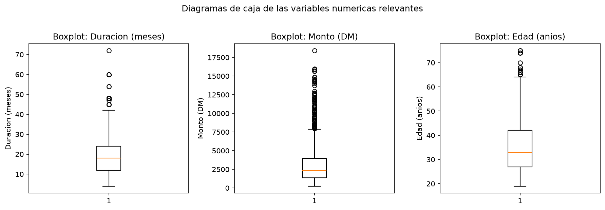
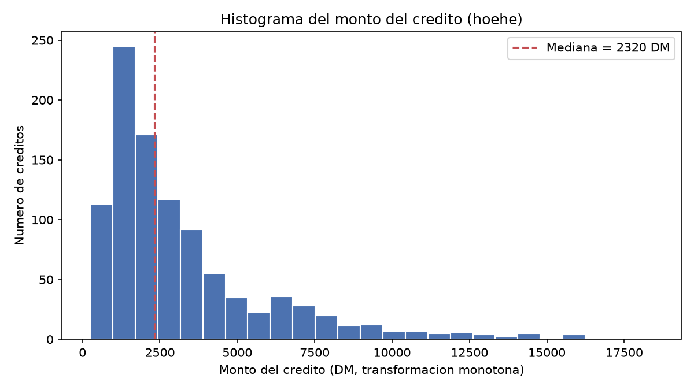
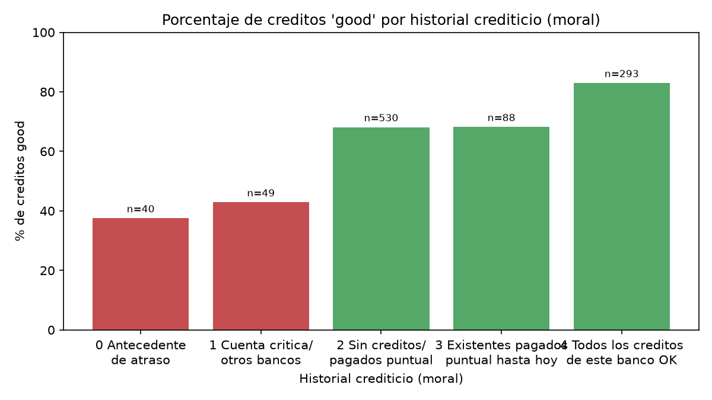
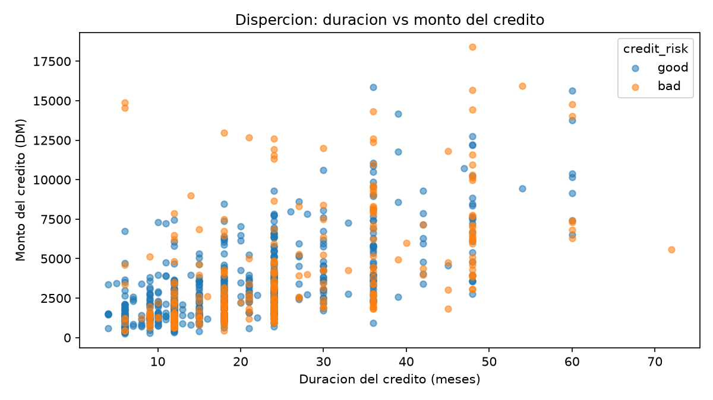
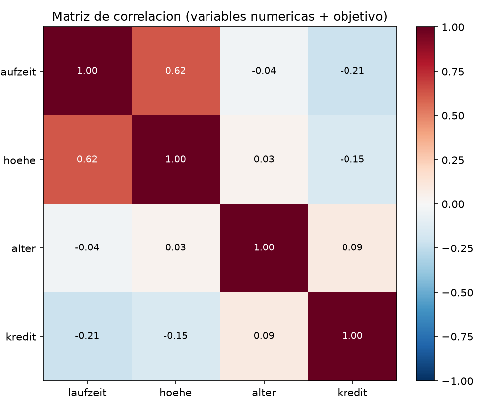

# Exploración técnica del conjunto de datos — South German Credit

**Proyecto:** Análisis de riesgo crediticio de clientes (Proyecto Integrador de Recursamiento)
**Unidad II:** Diagnóstico del conjunto de datos del Proyecto Integrador
**Alumno:** Alexander Domínguez Zárate · Matrícula 23301324
**Institución:** Universidad Tecnológica de Tula-Tepeji (UTTT)
**Fecha:** 2026-11-09
**Dataset:** [South German Credit (UCI, id 573)](https://archive.ics.uci.edu/dataset/573/south+german+credit) · 1000 registros × 21 variables

---

## 1) Herramientas técnicas utilizadas

| Herramienta | Versión/uso en este proyecto | Rol |
|---|---|---|
| Python | 3.15.2 | Lenguaje principal |
| Pandas | 3.1.0 | Carga, exploración y diagnóstico de calidad |
| NumPy | 2.5.4 | Operaciones numéricas para estadísticos y outliers |
| Matplotlib | 3.11.2 | Boxplots y visualizaciones de la sección 7 y 8 |
| Git y GitHub | Control de versiones del repositorio (`REC_ECBD_2026`) | Trazabilidad y evidencia de avance |
| Visual Studio Code / Jupyter | `notebooks/01_exploracion.ipynb` | Ejecución documentada paso a paso |

Todo el procedimiento es reproducible con: `py src/preprocessing/exploracion_tecnica.py` (regenera figuras y estadísticos) y con el notebook `notebooks/01_exploracion.ipynb`.

---

## 2) Carga y exploración inicial

```python
import pandas as pd
df = pd.read_csv('data/raw/SouthGermanCredit.asc', sep=' ')
```

### 2.1 `df.head()`

Muestra las primeras 5 filas con 21 columnas enteras (`laufkont`, `laufzeit`, `moral`, `verw`, `hoehe`, `sparkont`, `beszeit`, `rate`, `famges`, `buerge`, `wohnzeit`, `verm`, `alter`, `weitkred`, `wohn`, `bishkred`, `beruf`, `pers`, `telef`, `gastarb`, `kredit`).

**Interpretación.** El hallazgo central del primer contacto es que los datos vienen **totalmente codificados en enteros**: no hay texto ni unidades, y el dataset no es legible por sí solo; requiere el archivo `codetable.txt` para traducir los códigos (p. ej. `laufkont = status`, estado de la cuenta corriente). Además, las primeras filas casi todas son `kredit = 1` (crédito bueno): la muestra está **ordenada por la clase objetivo**, no por fecha, por lo que el orden del archivo nunca debe interpretarse como serie temporal.

### 2.2 `df.shape`

```text
(1000, 21)
```

**Interpretación.** 1000 créditos y 21 variables, exactamente lo publicado por UCI; no se perdieron filas en la lectura. 20 variables son candidatas a predictoras y `kredit` es la variable objetivo.

### 2.3 `df.columns`

**Interpretación.** Los nombres de columna están en alemán (`laufkont`, `moral`, `verw`, `hoehe`…) y no son autoexplicativos. Esto obliga a mantener visible el diccionario de datos (sección 3) durante todo el análisis y justifica crear versiones decodificadas (`*_cat`) en la preparación.

### 2.4 `df.info()`

```text
RangeIndex: 1000 entries, 0 to 999
Data columns (total 21 columns):
 #   Column    Non-Null Count  Dtype
 20  kredit    1000 non-null   int64
...
memory usage: 164.2 KB
```

**Interpretación.** Índice continuo 0–999 (sin filas omitidas), 1000 valores no nulos en cada una de las 21 columnas y memoria ligera (~164 KB). No existe ninguna columna de tipo `object` ni `datetime`.

### 2.5 `df.dtypes`

Todas las columnas son `int64`.

**Interpretación.** Variables conceptualmente **categóricas** (`laufkont`, `moral`, `verw`, `sparkont`…) llegan como números. Es una representación válida para modelar, pero peligrosa para interpretar: un algoritmo podría suponer que `verw = 10` (negocio) es "el doble" que `verw = 5` (electrodomésticos), comparación sin sentido. En la preparación hay que tratarlas como categóricas, distinguiendo ordinales de nominales.

### 2.6 `df.describe()`

| Variable | media | std | min | Q1 | 50 % | Q3 | max |
|---|---:|---:|---:|---:|---:|---:|---:|
| laufkont | 2.577 | 1.258 | 1 | 1 | 2 | 4 | 4 |
| laufzeit | **20.903** | 12.059 | 4 | 12 | 18 | 24 | **72** |
| moral | 2.545 | 1.083 | 0 | 2 | 2 | 4 | 4 |
| verw | 2.828 | 2.744 | 0 | 1 | 2 | 3 | 10 |
| hoehe | **3271.248** | 2822.752 | **250** | 1365.5 | 2319.5 | 3972.25 | **18424** |
| sparkont | 2.105 | 1.580 | 1 | 1 | 1 | 3 | 5 |
| beszeit | 3.384 | 1.208 | 1 | 3 | 3 | 5 | 5 |
| rate | 2.973 | 1.119 | 1 | 2 | 3 | 4 | 4 |
| famges | 2.682 | 0.708 | 1 | 2 | 3 | 3 | 4 |
| buerge | 1.145 | 0.478 | 1 | 1 | 1 | 1 | 3 |
| wohnzeit | 2.845 | 1.104 | 1 | 2 | 3 | 4 | 4 |
| verm | 2.358 | 1.050 | 1 | 1 | 2 | 3 | 4 |
| alter | **35.542** | 11.353 | **19** | 27 | 33 | 42 | **75** |
| weitkred | 2.675 | 0.706 | 1 | 3 | 3 | 3 | 3 |
| wohn | 1.928 | 0.530 | 1 | 2 | 2 | 2 | 3 |
| bishkred | 1.407 | 0.578 | 1 | 1 | 2 | 2 | 4 |
| beruf | 2.904 | 0.654 | 1 | 3 | 3 | 3 | 4 |
| pers | 1.845 | 0.362 | 1 | 2 | 2 | 2 | 2 |
| telef | 1.404 | 0.491 | 1 | 1 | 1 | 2 | 2 |
| gastarb | 1.963 | 0.189 | 1 | 2 | 2 | 2 | 2 |
| kredit | 0.700 | 0.458 | 0 | 0 | 1 | 1 | 1 |

**Interpretación.**

- Variables cuantitativas reales: `laufzeit` (4–72 meses), `hoehe` (250–18 424) y `alter` (19–75 años).
- Las variables codificadas se camuflan entre ellas: sus estadísticos carecen de interpretación monetaria o temporal; solo delimitan el rango de códigos usados.
- `kredit` tiene media 0.700: el **70 % de la muestra es `good`** (700 vs 300). El desbalance existe por diseño — los créditos malos fueron sobrerrepresentados al construir la muestra — y por eso su proporción no equivale a la tasa real de incumplimiento de 1973–1975.
- El 50 % central de los montos va de ~1 366 a ~3 972 DM, con media (3 271) > mediana (2 320): **sesgo a la derecha**.

---

## 3) Diccionario de datos

El detalle completo por campo solicitado (nombre, descripción, tipo en Python, tipo de variable, clasificación, unidad y utilidad) está en `docs/diccionario_datos/diccionario_datos.md`. Resumen:

| Variable | Descripción | Tipo Python | Tipo de variable | Clasificación | Unidad | Posible utilidad |
|---|---|---|---|---|---|---|
| `laufkont` | Estado de la cuenta corriente (catálogo 1–4) | int | Cualitativa | Ordinal | — | Proxy de liquidez; fuerte candidata clasificación |
| `laufzeit` | Duración del crédito | int | Cuantitativa | Discreta | meses | Objetivo/correlacionada con monto; clave en riesgo |
| `moral` | Historial de cumplimiento (0–4) | int | Cualitativa | Ordinal | — | Mayor poder discriminante de riesgo (fig. 3) |
| `verw` | Propósito del crédito (0–10) | int | Cualitativa | Nominal | — | Segmentación; entrada One-Hot |
| `hoehe` | Monto (transformación monótona del original) | int | Cuantitativa | Discreta | DM (aprox.) | Objetivo de regresión |
| `sparkont` | Ahorros (1–5) | int | Cualitativa | Ordinal | — | Capacidad de respaldo; clasificación |
| `beszeit` | Antigüedad en el empleo (1–5) | int | Cualitativa | Ordinal | años (intervalos) | Estabilidad laboral; ambas tareas |
| `rate` | Cuota como % del ingreso disponible (1–4, invertida: 1 = ≥35 %) | int | Cualitativa | Ordinal | % | Carga financiera; clasificación |
| `famges` | Estado civil + sexo combinados (1–4) | int | Cualitativa | Nominal | — | Con limitación: sexo no recuperable |
| `buerge` | Otro deudor/aval (1–3) | int | Cualitativa | Nominal | — | Riesgo compartido |
| `wohnzeit` | Años en residencia actual (1–4) | int | Cualitativa | Ordinal | años (intervalos) | Estabilidad domiciliaria |
| `verm` | Bien más valioso (1–4) | int | Cualitativa | Ordinal | — | Garantía implícita; clasificación/clustering |
| `alter` | Edad | int | Cuantitativa | Discreta | años | Perfil demográfico; clustering |
| `weitkred` | Otros planes de cuotas (1–3) | int | Cualitativa | Nominal | — | Sobreendeudamiento externo |
| `wohn` | Vivienda (1 gratis, 2 alquiler, 3 propia) | int | Cualitativa | Nominal | — | Clustering y Data Mart |
| `bishkred` | Nº de créditos en este banco (1–4, intervalos) | int | Cualitativa | Ordinal | créditos | Relación con el banco |
| `beruf` | Calidad del empleo (1–4) | int | Cualitativa | Ordinal | — | Perfil socioeconómico |
| `pers` | Personas a cargo (**código invertido**: 1 = «3+», 2 = «0–2») | int | Cualitativa | Ordinal (invertido) | personas | Carga familiar; requiere recodificación |
| `telef` | Línea telefónica a su nombre (1 = no, 2 = sí) | int | Cualitativa | Binaria | — | Histórico (años 70); trazabilidad |
| `gastarb` | Trabajador extranjero (1 = sí, 2 = no) | int | Cualitativa | Binaria | — | Variable sensible: uso ético/documentado |
| `kredit` | Resultado del contrato (0 = bad, 1 = good) | int | Cualitativa | Binaria | — | **Objetivo de clasificación** |

**Notas del diccionario** (remitir a la sección 5.3): `moral` empieza en 0; `pers` es ordinal invertido; `telef` y `gastarb` usan direcciones opuestas; `hoehe` es resultado de una transformación monótona no documentada.

---

## 4) Tipo y fuente de los datos

**Procedencia.** El dataset proviene de una **institución bancaria alemana** (créditos otorgados entre 1973 y 1975), documentada y corregida por el equipo de Prof. Ulrich Gromping (Open Data LMU) y distribuida en UCI Machine Learning Repository bajo licencia CC BY 4.0. Se descargó como `SouthGermanCredit.asc` (archivo de texto plano delimitado por espacios) junto con `codetable.txt` (tabla de códigos) y `read_SouthGermanCredit.R` (script oficial de lectura).

**Clasificación por origen.** Corresponden a **datos de transacciones/generados por personas** (registro humano-institucional), no a datos de sensores, web, redes sociales ni biométricos: cada fila es una decisión crediticia humana — un asesor registrando datos del solicitante (edad, empleo, ahorros, vivienda) y el desenlace real del contrato (cumplió o no). No hay componente automático de máquina: la única señal "artificial" es que los montos fueron **transformados monótonamente** (des-identificación) antes de publicarse.

**Estructura.** Son datos **estructurados**: esquema fijo de 21 columnas, filas homogéneas, tipos definidos y valores pertenecientes a catálogos, sin texto libre ni jerarquías anidadas. Es el tipo ideal para un Data Warehouse/Data Mart relacional (modelo estrella propuesto en `docs/analisis/propuesta_dw_datamart.md`).

**Implicaciones para el proyecto.** (i) Al ser transaccional humano existe riesgo de sesgo de origen (muestreo estratificado con `bad` sobrerrepresentado); (ii) la antigüedad (1973–1975) limita la validez externa — los hallazgos describen ese contexto, no el actual; (iii) la tabla de códigos es la "única" fuente de verdad, por lo que cualquier ETL debe partir de ella.

---

## 5) Diagnóstico de calidad

### 5.1 Valores faltantes

```python
df.isnull().sum()
```

Resultado: **0 valores faltantes en todas y cada una de las 21 variables** (1000 no nulos por columna en `df.info()`), coherente con la ficha oficial de UCI (*Has Missing Values? No*): la suma total es `0` y el porcentaje el `0.00 %`.

**Tratamiento propuesto para etapas posteriores (sin eliminar datos).** No imputar en esta etapa. En un dataset codificado, un dato perdido no aparecería como `NaN` sino como **código inválido tras la decodificación**; por eso la barrera correcta es la validación de rangos (5.3). Regla defensiva para el ETL: si algún registro trae un código fuera de catálogo, se recodifica como categoría "desconocido" en las variables categóricas (y nunca descartar filas en un dataset de solo 1000 registros); la desviación se reportará en el registro de calidad del DW.

### 5.2 Registros duplicados

```python
df.duplicated().sum()
```

Resultado: **0 registros duplicados exactos**.

**Causa posible.** En realidad aquí no hay duplicados; la causa típica que este chequeo busca es la captura manual repetida o los *joins* de un ETL. En este proyecto el riesgo más plausible es **duplicar filas al cargar el mismo archivo dos veces en el Data Warehouse** (o un `merge` mal especificado).

**Tratamiento propuesto.** Sin cambios en los datos crudos. En el ETL se agregará una **llave primaria sintética** (`sk_credito`) y se repetirá `duplicated().sum()` después de cada transformación para detectar duplicados *inducidos por el código*. Nota de criterio: dos créditos con la misma combinación de los 21 campos pueden existir legítimamente (clientes con perfiles idénticos), y por eso la comprobación se hace a nivel de fila exacta y se dejará documentada en el DW, no en el origen.

### 5.3 Valores incorrectos o inconsistentes

Validación automática contra el catálogo (`codetable.txt`) y rangos lógicos de negocio:

```python
codigos_validos = { 'laufkont': range(1,5), 'moral': range(0,5), 'verw': range(0,11),
    'sparkont': range(1,6), 'beszeit': range(1,6), 'rate': range(1,5), 'famges': range(1,5),
    'buerge': range(1,4), 'wohnzeit': range(1,5), 'verm': range(1,5), 'weitkred': range(1,4),
    'wohn': range(1,4), 'bishkred': range(1,5), 'beruf': range(1,5), 'pers': range(1,3),
    'telef': range(1,3), 'gastarb': range(1,3), 'kredit': range(0,2) }
# + duracion > 0, monto > 0, edad >= 18
```

Resultado:

| Chequeo | Resultado |
|---|---|
| Códigos fuera de catálogo | **0** (ninguna columna reporta `FUERA DE CODIGO`) |
| Catálogo sin datos | `verw` código **7 (educación)** no aparece en ningún registro |
| Duración ≤ 0 | 0 |
| Monto ≤ 0 | 0 |
| Clientes menores de 18 años | 0 |

**Hallazgos documentados (inconsistencias "de codificación", no de captura):**

1. **`moral` inicia en 0** mientras el resto de las ordinales inicia en 1. Riesgo: al codificarlo como escala estándar 1–5 se desplazaría el significado de cada categoría.
2. **`pers` es ordinal invertido**: código 1 = "3 o más personas a cargo", código 2 = "0 a 2". Tratarlo como ascendente invierte por completo su significado.
3. **`telef` y `gastarb` tienen direcciones opuestas** (`telef`: 1 = no, 2 = sí; `gastarb`: 1 = sí, 2 = no). Si se modelo directamente, el signo de sus coeficientes sería ininterpretable; deben homogeneizarse a 0/1 con significado único ("1 = sí") antes de modelos lineales.
4. **`verw = 7` es una categoría vacía**: existe en el catálogo pero sin registros. En One-Hot generará una columna nula que conviene descartar.
5. **`hoehe` es una transformación monótona** del monto original (UCI no documenta el tipo exacto). Las comparaciones de orden son válidas, pero no es el monto exacto en DM; debe documentarse como limitación para interpretar unidades monetarias exactas.
6. **`famges` mezcla sexo y estado civil**: el sexo no es recuperable (los varones solteros y mujeres no solteras comparten el código 2). es una limitación estructural del dataset, no un error.
7. **Valores extremos plausibles pero altos**: 72 meses, 18 424 DM, 75 años:  quedan dentro de rangos lógicos y se analizan en la sección 7 (atípicos), no como errores.

**Conclusión de la sección.** El dataset está "curado", sin errores de captura; las inconsistencias reales son de diseño de codificación, no de calidad de observaciones.

---

## 6) Análisis estadístico inicial

Variables seleccionadas por su centralidad en el problema: **`laufzeit`** (plazo), **`hoehe`** (monto) y **`alter`** (edad).

| Estadístico | `laufzeit` (meses) | `hoehe` (DM aprox.) | `alter` (años) |
|---|---:|---:|---:|
| Media | 20.90 | 3 271.25 | 35.54 |
| Mediana | 18.00 | 2 319.50 | 33.00 |
| Mínimo | 4 | 250 | 19 |
| Máximo | 72 | 18 424 | 75 |
| Desviación estándar | 12.06 | 2 822.75 | 11.35 |
| Q1 / Q3 | 12 / 24 | 1 365.5 / 3 972.25 | 27 / 42 |

**Interpretación.**

- **`laufzeit`:** media 20.90 vs mediana 18 — la mayoría de los créditos son de 6–24 meses con una cola de plazos largos (máx. 72). Es relevante para el riesgo: la clase `bad` tiene duración media de **24.86 meses frente a 19.21** de `good`, es decir, **plazos más largos se asocian a más riesgo**. La correlación con el monto (0.625) es la más fuerte del dataset.
- **`hoehe`:** media 3 271, mediana 2 320 y desviación estándar **2 823 (casi del tamaño de la mediana)**: dispersión altísima y sesgo a la derecha. Los créditos `bad` promedian **3 938 DM frente a 2 985** de los `good`: montos mayores se asocian a riesgo. Esta magnitud de dispersión es la razón técnica por la que la regresión del monto exigirá escalado o log.
- **`alter`:** media 35.5, mediana 33, rango 19–75 — población adulta-joven. El contraste por clase es débil (`bad` promedia 34.0 vs `good` 36.2) y la correlación con `kredit` es casi nula (0.091): **la edad, por sí sola, no discriminara el riesgo**; su valor está en el clustering de perfiles.

---

## 7) Detección inicial de valores atípicos

Técnica: **boxplots** con regla de Tukey (`Q1 − 1.5·IQR`, `Q3 + 1.5·IQR`). **No se eliminó ningún registro** en esta etapa.



Resultados cuantitativos:

| Variable | Límite superior | Nº outliers | % |
|---|---:|---:|---:|
| `laufzeit` | 42 meses (máx 72) | 70 | 7.0 % |
| `hoehe` | 7 882 DM (máx 18 424) | 72 | 7.2 % |
| `alter` | 64.5 años (máx 75) | 23 | 2.3 % |

**Descripción del comportamiento y tratamiento propuesto:**

- **`laufzeit` (70 atípicos).** La caja queda pegada al límite porque los plazos son múltiplos comerciales (24, 30, 36…); fuera del límite aparecen 45, 47, 48, 54, 60 y 72 meses. Son **plazos reales de la época, no errores**. Propuesta: agrupar en "corto/medio/largo plazo" en vez de recortar, conservando su señal predictiva.
- **`hoehe` (72 atípicos).** La cola llega a 18 424 DM: son créditos grandes reales (varios de ellos resultan `bad`). Propuesta: **estandarización** para modelos lineales o transformación logarítmica; jamás eliminación de filas.
- **`alter` (23 atípicos).** Clientes de 65 a 75 años: mayores reales. Propuesta: conservar; en el Data Mart puede crearse el grupo "65+" para reportes.

**Lección del punto.** Los tres grupos de atípicos corresponden a **perfiles financieros reales y legítimos**, no a errores de captura. El dataset no necesita limpieza agresiva, sino transformación adecuada según el tipo de modelo; cualquier "recorte" habría borrado exactamente los casos más interesantes para el negocio (grandes créditos o plazos largos, que es donde se concentra el riesgo).

---

## 8) Visualización inicial

Se generaron cuatro visualizaciones con título y ejes identificados (además de los boxplots de la sección 7). Todas están guardadas en `docs/analisis/figuras/` como `fig1`–`fig5` y reproducibles con `py src/preprocessing/exploracion_tecnica.py`.

### 8.1 Histograma del monto (`hoehe`)



**Interpretación.** El grueso de los créditos está entre 250 y 6 000 DM con una larga cola a la derecha hasta 18 424 DM. La mediana (2 320 DM) queda claramente a la izquierda de la media (3 271 DM): sesgo positivo clásico ya observado en `describe()`. Implicación práctica: sin transformación log o escalado, los modelos lineales quedarían dominados por pocos créditos grandes.

### 8.2 Barras: tasa de pago según historial crediticio (`moral`)



**Interpretación.** Los créditos con historial problemático (`moral = 0` y `1`) muestran la **menor** tasa de pago (< 50 % de `good`, en rojo), mientras que "todos los créditos de este banco OK" (`moral = 4`, n = 293) supera el 85 % (verde). Es el comportamiento esperado por conocimiento de dominio y confirma que **el historial será la variable con mayor poder de separación** en la clasificación de la Unidad III, además del tipo de regla (rojo/verde) que el dashboard podrá comunicar.

### 8.3 Dispersión: duración vs monto, coloreado por resultado



**Interpretación.** La correlación `laufzeit–hoehe` es 0.625 (positiva y fuerte): la nube crece en diagonal, a mayor plazo mayor monto. Los casos `bad` se concentran en la zona de **plazos largos y montos grandes**; los `good` dominan la esquina de plazos cortos. Esta figura es el fundamento visual directo de la propuesta de regresión (sección 9) y de parte de la lógica de clasificación.

### 8.4 Matriz de correlación (variables numéricas + objetivo)



**Interpretación.** Entre predictoras no hay colinealidad fuerte (máximo 0.63 entre monto y plazo): buena noticia para una regresión lineal. `kredit` se correlaciona negativamente con duración (−0.215) y monto (−0.155): plazos más cortos y montos menores se asocian a créditos buenos. Con `alter` la relación es casi nula (0.091): la edad, por sí sola, no aporta a la clasificación y probablemente entre con peso pequeño. Recordar el caveat de la sección 5.3: `hoehe` está transformada, por lo que las correlaciones valen en dirección y orden, no como pesos exactos en DM.

---

## 9) Preparación para análisis posteriores (tres propuestas)

**9.1 Regresión — objetivo: `hoehe`.** Predecir el monto del crédito a partir de `laufzeit` (correlación 0.625, la relación más fuerte del dataset), `laufkont` (estado de cuenta como proxy de capacidad de pago), `verw` (propósito), `sparkont`, `beszeit`, `moral` y `alter`. Se justifica con la pregunta de Unidad I: el problema no es solo "¿pagará?" sino **"¿cuánto se expone el banco?"** — un crédito grande fallido cuesta mucho más que uno pequeño; el R² ya observado en la primera implementación (0.574) indica que el monto tiene estructura predecible.

**9.2 Clasificación — objetivo: `kredit`, clases 0 = bad / 1 = good.** Variables candidatas: `moral` (la más discriminante según la fig. 8.2), `laufkont`, `laufzeit`, `sparkont`, `beszeit`, `verm` y `bishkred`. Restricción documentada: desbalance 700/300 existente **por diseño de la muestra**; por eso la métrica principal de evaluación no será *accuracy*, sino **recall/F1 de la clase `bad` y ROC–AUC**, conforme a lo especificado en el README.

**9.3 Agrupamiento (clustering).** Perfiles de cliente a partir de `hoehe`, `laufzeit` y `alter` estandarizadas combinadas con `sparkont`, `verm`, `wohn`, `beszeit` y `laufkont` codificadas, buscando 3–5 segmentos. Evaluación: Silhouette + validación de negocio (tasa de `bad` y monto medio por cluster). Su salida alimentará el Data Mart (`dm_riesgo_crediticio`) y el dashboard, que es el entregable de Unidad IV.

---

## 10) Conclusión del diagnóstico

1. **¿Qué información contiene el dataset?** 1000 solicitudes de crédito de un banco alemán (1973–1975) descritas con 21 variables: cuenta corriente, historial, propósito, montos/plazos, ahorros, empleo, residencia, bienes, dependientes y el resultado del contrato (`kredit`).
2. **¿Cuál es su nivel general de calidad?** **Alto**: 0 faltantes, 0 duplicados, 0 códigos fuera de catálogo y 0 errores lógicos; es un dataset "curado".
3. **¿Qué problemas fueron identificados?** Desbalance 70/30 por diseño de muestreo; colisiones de codificación (`moral` desde 0, `pers` ordinal invertido, `telef`/`gastarb` con direcciones opuestas); categoría vacía `verw = 7`; `hoehe` con transformación monótona no documentada; `famges` que mezcla sexo y estado civil.
4. **¿Qué variables requieren tratamiento?** Las 18 codificadas deben decodificarse con `codetable.txt`; las binarias deben homogeneizarse a 0/1; `hoehe` requiere escalado/log para modelos sensibles a escala; `famges` debe documentarse como limitación estructural.
5. **¿Existen valores faltantes?** **No** (0 de 1000 en todas las columnas).
6. **¿Existen registros duplicados?** **No** (0).
7. **¿Existen valores atípicos?** **Sí**: 70 en duración (7.0 %), 72 en monto (7.2 %), 23 en edad (2.3 %), todos plausibles y **no eliminados**.
8. **¿Qué transformaciones serán necesarias?** Decodificación, normalización 0/1 de binarias, One-Hot para nominales, escalado para modelos lineales, creación de `sk_credito` y carga al Data Warehouse/Data Mart propuesto.
9. **¿Los datos son adecuados para continuar con el Proyecto Integrador?** **Sí**: la calidad es alta, el tamaño (1000 × 21) es manejable para ETL y modelos, y ya hay señales útiles (monto, plazo, historial) alineadas con los objetivos definidos en la Unidad I.
10. **¿Qué conocimiento podría obtenerse posteriormente?** Tasas de riesgo por perfil/segmento, importancia relativa de cada variable, estimación del monto solicitado (regresión), reglas del tipo "historial X + plazo Y → riesgo Z" (clasificación) y segmentos de cliente (clustering) que estructurarán el Data Mart y el dashboard.

---

## Anexo — Reproducibilidad

```bash
# Figuras y estadísticos de este informe
py src/preprocessing/exploracion_tecnica.py

# Exploración paso a paso (header, info, diagnóstico, gráficas)
jupyter notebook notebooks/01_exploracion.ipynb
```

**Archivos asociados:** `docs/diccionario_datos/diccionario_datos.md` (diccionario con los 8 campos solicitados), `docs/analisis/figuras/fig1 a fig5 (.png)`, `notebooks/01_exploracion.ipynb`.
