# Análisis de riesgo crediticio con metodología KDD/CRISP-DM: ETL, Data Mart y aprendizaje supervisado y no supervisado sobre el dataset South German Credit

**Proyecto Integrador de Recursamiento — Extracción de Conocimiento en Bases de Datos**
Universidad Tecnológica de Tula-Tepeji (UTTT)

**Alumno:** Alexander Domínguez Zárate · **Matrícula:** 23301324
**Versión:** borrador para entrega final · **Fecha:** 2026-11-16

---

## Resumen

Este proyecto aplica la metodología KDD con la organización de CRISP-DM al dataset *South German Credit* (1 000 créditos alemanes de 1973–1975, 21 variables; *South German Credit* [Dataset], 2020) para responder si los perfiles de los solicitantes explican y predicen el comportamiento de los créditos. El trabajo cubre el ciclo completo: diagnóstico y preparación de datos (ETL con un contrato de calidad de siete chequeos), diseño e implementación de un Data Warehouse/Data Mart en esquema estrella (SQLite), modelos supervisados de regresión y clasificación, análisis no supervisado con PCA y K-means, y un dashboard HTML autocontenido alimentado por el Data Mart. Los resultados principales son: (a) un gradiente de riesgo monotónico por historial crediticio (62.5 % de créditos malos con atraso previo frente a 17.1 % con historial limpio); (b) una relación no lineal entre monto y riesgo, con 54.3 % de créditos malos en montos ≥ 8 000 DM; (c) un clasificador de regresión logística regularizada y balanceada con ROC-AUC de 0.835 en prueba, que detecta el 77 % de los créditos malos; (d) una regresión del monto (RidgeCV) que explica el 60 % de su varianza; y (e) dos segmentos naturales derivados sin usar la respuesta —exposición alta (254 clientes, 43.7 % malos) y exposición baja (746, 25.3 %)— que validan la exposición como variable maestra del negocio. Se discuten las limitaciones de la época, el tamaño de muestra y el carácter no causal de los hallazgos.

**Palabras clave:** riesgo crediticio, KDD, CRISP-DM, ETL, Data Warehouse, clasificación, regresión, clustering, PCA.

---

## Índice

1. [Introducción](#1-introducción)
2. [Marco teórico y metodológico](#2-marco-teórico-y-metodológico)
3. [Materiales y métodos](#3-materiales-y-métodos)
4. [Unidad II — Diagnóstico, preparación de datos y Data Mart](#4-unidad-ii--diagnóstico-preparación-de-datos-y-data-mart)
5. [Unidad III — Modelado supervisado](#5-unidad-iii--modelado-supervisado)
6. [Unidad IV — Análisis no supervisado](#6-unidad-iv--análisis-no-supervisado)
7. [Dashboard y storytelling](#7-dashboard-y-storytelling)
8. [Discusión integrada](#8-discusión-integrada)
9. [Limitaciones](#9-limitaciones)
10. [Conclusiones](#10-conclusiones)
11. [Referencias](#referencias)
12. [Anexos](#anexos)

---

## 1. Introducción

La concesión de crédito es una de las decisiones de negocio más sensibles de la banca: aceptar a un deudor que incumplirá genera pérdida directa, mientras que rechazar a uno solvente representa costo de oportunidad. La minería de datos ofrece herramientas para sustentar esa decisión en evidencia histórica (Fayyad et al., 1996; Han et al., 2012).

Este proyecto analiza el dataset **South German Credit** (UCI Machine Learning Repository, identificador 573; *South German Credit* [Dataset], 2020): 1 000 créditos otorgados entre 1973 y 1975, con 20 variables predictoras (financieras, crediticias, laborales, personales y habitacionales) y una variable objetivo binaria `kredit` (0 = malo, 1 = bueno). El dataset es la versión corregida y documentada del clásico *Statlog German Credit* (Groemping, 2019), lo que añade valor didáctico: incluye un catálogo de códigos (`codetable.txt`) que exige un proceso formal de decodificación.

**Pregunta principal.** ¿Qué patrones presentes en las características financieras, crediticias y personales de los clientes permiten explicar y modelar el comportamiento observado de los créditos?

**Preguntas específicas.**

1. **Clasificación:** ¿es posible clasificar un crédito como bueno o malo con las características disponibles al momento de la solicitud?
2. **Regresión:** ¿es posible estimar el monto del crédito (`hoehe`) a partir de las demás características?
3. **No supervisado:** ¿es posible identificar grupos de clientes con perfiles financieros y crediticios similares?

**Objetivo general.** Analizar y transformar los datos mediante técnicas de KDD para identificar patrones relacionados con el riesgo crediticio, desarrollar modelos supervisados y no supervisados, y comunicar los resultados mediante visualización.

**Objetivos específicos.**

1. Documentar estructura, características y calidad del dataset (diccionario de datos y análisis exploratorio).
2. Diseñar e implementar la preparación y transformación de datos (ETL).
3. Diseñar e implementar un Data Warehouse/Data Mart que organice la información.
4. Desarrollar y evaluar modelos de clasificación y regresión.
5. Aplicar clustering y reducción de dimensionalidad para identificar perfiles de clientes.
6. Construir un dashboard que comunique los principales hallazgos.

**Alcance.** El proyecto cubre el ciclo completo de KDD sobre un dataset académico. Los modelos tienen finalidad académica y analítica: no se proponen para aprobar o rechazar créditos reales.

---

## 2. Marco teórico y metodológico

### 2.1 KDD y CRISP-DM

El proceso de **Descubrimiento de Conocimiento en Bases de Datos (KDD)** comprende la selección, el preprocesamiento, la transformación, la minería de datos y la interpretación/evaluación de los patrones obtenidos (Fayyad et al., 1996). **CRISP-DM** lo organiza en seis fases iterativas —comprensión del negocio, comprensión de los datos, preparación, modelado, evaluación y despliegue— (Wirth & Hipp, 2000). Este proyecto sigue ambas referencias: cada fase del pipeline documentado (bitácora en `docs/Informe de cambios`) corresponde a una fase de CRISP-DM, y cada entregable a un paso de KDD.

### 2.2 Riesgo crediticio y desbalance de clases

En datos crediticios la clase de interés suele ser minoritaria: aquí 300 créditos son malos (30 %) y 700 buenos (70 %). Evaluarse solo con *exactitud* sería engañoso (predecir todo "bueno" logra 70 % sin detectar ningún malo); por ello se usan precision, recall, F1, matriz de confusión y ROC-AUC. La **accuracy se reporta igualmente** (72.5 % en prueba) por completitud de la evaluación, pero se interpreta como métrica secundaria: depende de la prevalencia y apenas supera el 70 % de un clasificador trivial. La clase positiva de análisis se define como **malo (bad)**, porque es lo que el banco debe detectar.

### 2.3 Técnicas empleadas

| Técnica | Uso en el proyecto | Referencia |
|---|---|---|
| ETL y validaciones | Extracción, transformación, carga y contrato de calidad | Kimball & Ross (2013) |
| Modelo estrella | Data Mart: 8 dimensiones + tabla de hechos | Kimball & Ross (2013) |
| Regresión lineal regularizada (OLS, Ridge) | Predicción del monto | James et al. (2021) |
| Regresión logística y RandomForest | Clasificación del riesgo | Pedregosa et al. (2011) |
| Validación cruzada (k-fold, estratificada) | Selección de modelos sin fuga | James et al. (2021) |
| K-means y silhouette | Segmentación no supervisada | Rousseeuw (1987) |
| PCA | Reducción de dimensionalidad | Jolliffe & Cadima (2016) |

---

## 3. Materiales y métodos

### 3.1 Dataset

| Característica | Detalle |
|---|---|
| Fuente | UCI ML Repository, id 573, CC BY 4.0 (*South German Credit* [Dataset], 2020) |
| Registros | 1 000 (700 buenos / 300 malos; muestra estratificada con malos sobrerrepresentados) |
| Variables | 21: 3 cuantitativas (`laufzeit` plazo, `hoehe` monto, `alter` edad), 17 categóricas/ordinales/binarias |
| Faltantes | No reportados |
| Particularidad | 100 % codificado en enteros; el monto (`hoehe`) es el resultado de una transformación monótona no documentada (no DM exactos) |

### 3.2 Arquitectura del pipeline

```text
data/raw/SouthGermanCredit.asc          (1000 x 21, enteros)
   │  1) ETL: src/etl/etl_south_german_credit.py
   ▼
data/processed/south_german_credit_processed.csv   (1000 x 40)
   │  2) DW/DM: src/etl/build_dw_sqlite.py + sql/schema_dw_sqlite.sql
   ▼
data/processed/dw_south_german_credit.db           (modelo estrella)
   │  3) Modelos: src/models/*.py        4) No supervisado: src/models/clustering_pca.py
   ▼                                     ▼
modelos/{regresion,clasificacion,clustering}/*.pkl + metricas.json
   │  5) Dashboard: src/dashboard/generar_dashboard.py
   ▼
dashboard/index.html   (HTML autocontenido)
```

Cada etapa es un script reproducible con rutas relativas a la raíz del repositorio y `random_state=42`. La separación entre **datos originales** (`data/raw/`, inmutables) y **datos procesados** (`data/processed/`, generados) está documentada en `data/README.md`.

### 3.3 Decisiones transversales de calidad

- **Contrato post-ETL de 7 chequeos** (§ 4.4): si una fase posterior lo rompe, el reporte JSON indica cuál falló.
- **Prevención de fuga de información (leakage):** en ambos modelos supervisados se excluyen `kredit`, `kredit_cat` y `cuota_aprox_mensual` (función determinista de monto/plazo).
- **Semilla fija 42** en particiones, CV, K-means y PCA.

---

## 4. Unidad II — Diagnóstico, preparación de datos y Data Mart

### 4.1 Diagnóstico y análisis exploratorio

El análisis exploratorio (Unidad II, `docs/analisis/exploracion_tecnica.md`) estableció: (a) 0 valores faltantes y 0 duplicados en el archivo crudo; (b) desbalance 70/30 de la clase objetivo (Figura 1); (c) distribuciones de `hoehe` y `laufzeit` sesgadas a la derecha, con créditos de hasta 18 000 DM y 72 meses; y (d) correlación fuerte entre monto y plazo, con riesgo creciente en los extremos.

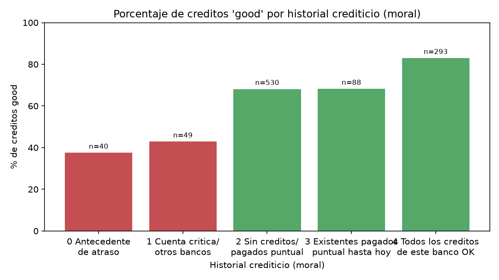

**Figura 1.** Distribución del riesgo por historial crediticio (`moral`): el gradiente que luego guiará la clasificación. Fuente: elaboración propia con matplotlib (`src/preprocessing/figuras_fuente.py`).

Hallazgos de codificación relevantes (documentados en el diccionario de datos v2): `moral` inicia en 0; `rate` y `pers` son ordinales **invertidas**; `telef` y `gastarb` usan direcciones opuestas (1 = "no" en `telef`, 1 = "sí" en `gastarb`); la categoría `verw = 7` (educación) existe en el catálogo pero no en los datos; y `famges` mezcla sexo y estado civil (el sexo no es recuperable de la variable, según la documentación oficial del dataset).

### 4.2 Transformación

El ETL decodifica las 17 variables de catálogo a columnas `*_cat` con las etiquetas legibles, **conservando los códigos originales** (trazabilidad y compatibilidad con los modelos). Se agrega una variable derivada de carga financiera:

- `cuota_aprox_mensual = hoehe / laufzeit` (redondeo a 2 decimales): media **167.69 DM/mes**, mediana 130.33, máximo 2 482.67 (crédito grande de plazo corto).

Es un *proxy* de la carga mensual, no la cuota contractual real (que depende de `rate`, el porcentaje del ingreso disponible).

### 4.3 ETL y contrato de calidad

El script `src/etl/etl_south_german_credit.py` produce el dataset procesado (1 000 × 40) y ejecuta la función `validate()` con **siete chequeos**, todos OK en la última ejecución (Tabla 1). La decisión de diseño fue **no imputar valores**: la defensa contra códigos nuevos o faltantes es el chequeo 5, que detendría el pipeline si aparecieran.

**Tabla 1.** Contrato de calidad post-ETL (resultado: 7/7 OK)

| # | Chequeo | Riesgo que cubre |
|---|---|---|
| 1 | filas_conservadas (1000 = 1000) | pérdida/duplicación de filas |
| 2 | sin_nulos (0) | faltantes introducidos por transformaciones |
| 3 | sin_duplicados (0) | duplicados por `merge` o carga doble |
| 4 | códigos_en_catálogo | códigos inválidos no contemplados |
| 5 | decodificación completa (`*_cat` sin NaN) | código nuevo sin mapeo (sustituye a la imputación) |
| 6 | cuota_aprox consistente | errores de redondeo/deriva en la derivada |
| 7 | rangos lógicos (plazo 1–120, monto > 0, edad 18–100) | valores absurdos en cuantitativas |

*Nota.* El reporte auditable se guarda en `data/processed/reporte_calidad_etl.json`.

### 4.4 Data Warehouse / Data Mart

El diseño se propuso en PostgreSQL (`sql/schema_dw.sql`) y se **implementó en SQLite** (`sql/schema_dw_sqlite.py` + `src/etl/build_dw_sqlite.py`), decisión técnica documentada: permite validar la integridad referencial sin servidor de base de datos, conservando el DDL PostgreSQL como entrega teórica.

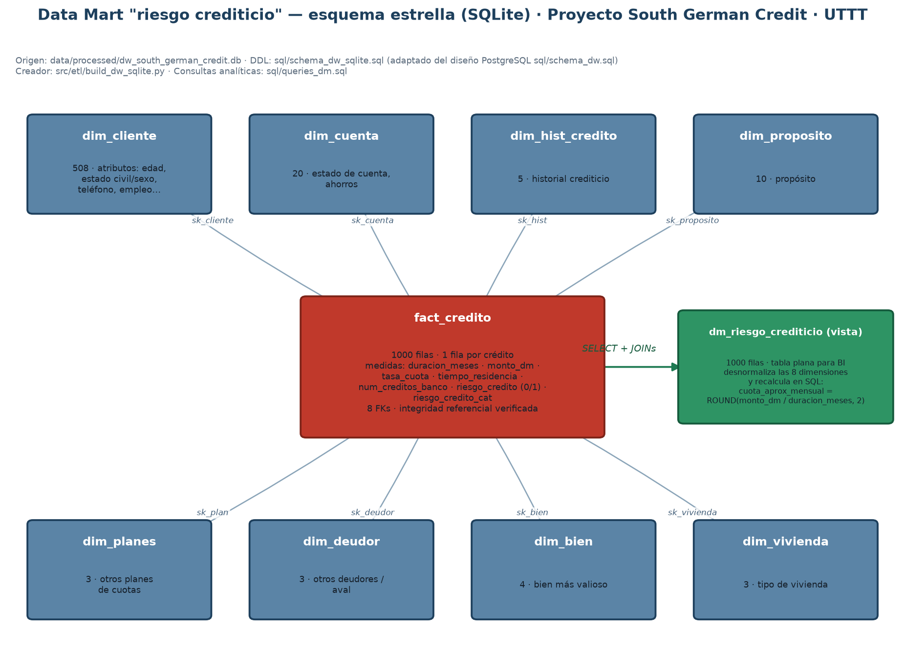

**Figura 2.** Esquema estrella del Data Mart implementado (conteos leídos en vivo de la base). Fuente: elaboración propia (`src/etl/diagrama_dw.py`).

El modelo estrella tiene 8 dimensiones desduplicadas (SCD tipo 0) alrededor de `fact_credito` (1 000 filas, granularidad = 1 crédito, 8 FKs verificadas con `PRAGMA foreign_key_check`, 0 violaciones). La vista de consumo `dm_riesgo_crediticio` desnormaliza el modelo y recalcula `cuota_aprox_mensual` en SQL, lo que permite contrastar ETL y DW.

Las cinco consultas analíticas (`sql/queries_dm.sql`) responden preguntas de negocio con resultados reales (Tabla 2).

**Tabla 2.** Hallazgos de las consultas analíticas del Data Mart

| Consulta | Pregunta | Hallazgo principal |
|---|---|---|
| Q1 | ¿Qué historial concentra el riesgo? | Gradiente monotónico: 62.5 % bad (atraso) → 17.1 % (historial limpio) |
| Q2 | ¿Dónde se pide más dinero? | `business` promedia 8 209 DM (12 créditos); `furniture` es el más frecuente (280) |
| Q3 | ¿Riesgo por cuenta y ahorros? | "Sin cuenta + sin ahorros" 52.1 % bad vs. "cuenta ≥ 200 DM + ahorros ≥ 1000" 9.1 % (×5.7) |
| Q4 | ¿Cuáles son los créditos de mayor exposición? | Top-10 por cuota mensual con 40 % bad; los dos mayores (≈ 2 400–2 500 DM/mes) incumplieron |
| Q5 | ¿El riesgo escala con el monto? | Patrón no lineal: 28.8 % → 23.9 % → 38.1 % → **54.3 %** en ≥ 8 000 DM |

---

## 5. Unidad III — Modelado supervisado

### 5.1 Diseño experimental común

| Aspecto | Regresión (`hoehe`) | Clasificación (`kredit`) |
|---|---|---|
| Split | 80/20 (`random_state=42`) | 80/20 estratificado |
| Validación | KFold 5 (train) | StratifiedKFold 5 (train) |
| Preprocesamiento | OneHot (categóricas) + StandardScaler (numéricas) | idéntico |
| Baseline | DummyRegressor (mediana) | DummyClassifier (mayoritaria) |
| Clase positiva | — | bad (`kredit = 0`) |
| Exclusiones | `kredit`, `kredit_cat`, `cuota_aprox_mensual` | idénticas |

El umbral de decisión de la clasificación se ajustó **solo con train** (`cross_val_predict` out-of-fold); el conjunto de prueba se reservó para la evaluación final.

### 5.2 Regresión del monto

Con CV 5-fold sobre train, `RidgeCV` resultó el mejor candidato (Tabla 3). La regularización L2 estabiliza las ~60 dummies del one-hot.

**Tabla 3.** Comparación por CV 5-fold (train, 800 créditos)

| Modelo | RMSE (DM) | R² |
|---|---:|---:|
| **RidgeCV** (α = 31.62) | **1 887 ± 217** | **0.550** |
| Ridge α = 1 | 1 902 | 0.543 |
| OLS | 1 909 | 0.540 |
| Baseline (mediana) | 2 975 | −0.121 |

**Tabla 4.** Métricas en prueba (200 créditos)

| Métrica | Valor | Lectura |
|---|---:|---|
| R² | **0.596** | explica ≈ 60 % de la varianza del monto |
| RMSE | 1 798 DM | error típico ≈ 55 % del monto medio (3 271 DM) |
| MAE | 1 139 DM | < RMSE ⇒ errores grandes concentrados en pocos casos |

Los coeficientes estandarizados son interpretables: `laufzeit` (+1 488 DM por σ) domina, seguida de la estructura de cuota (`rate_lt20` −1 043; `rate_ge35` +925), el propósito (`business` +615; `car_new` +538) y el historial de atraso (+397). El diagnóstico gráfico (Figuras 3 y 4) muestra buen ajuste en 2 000–6 000 DM con **saturación en los extremos**: los créditos > 8 000 DM quedan subestimados. Conclusión: modelo útil para presupuestar exposición agregada, no para fijar montos individuales.

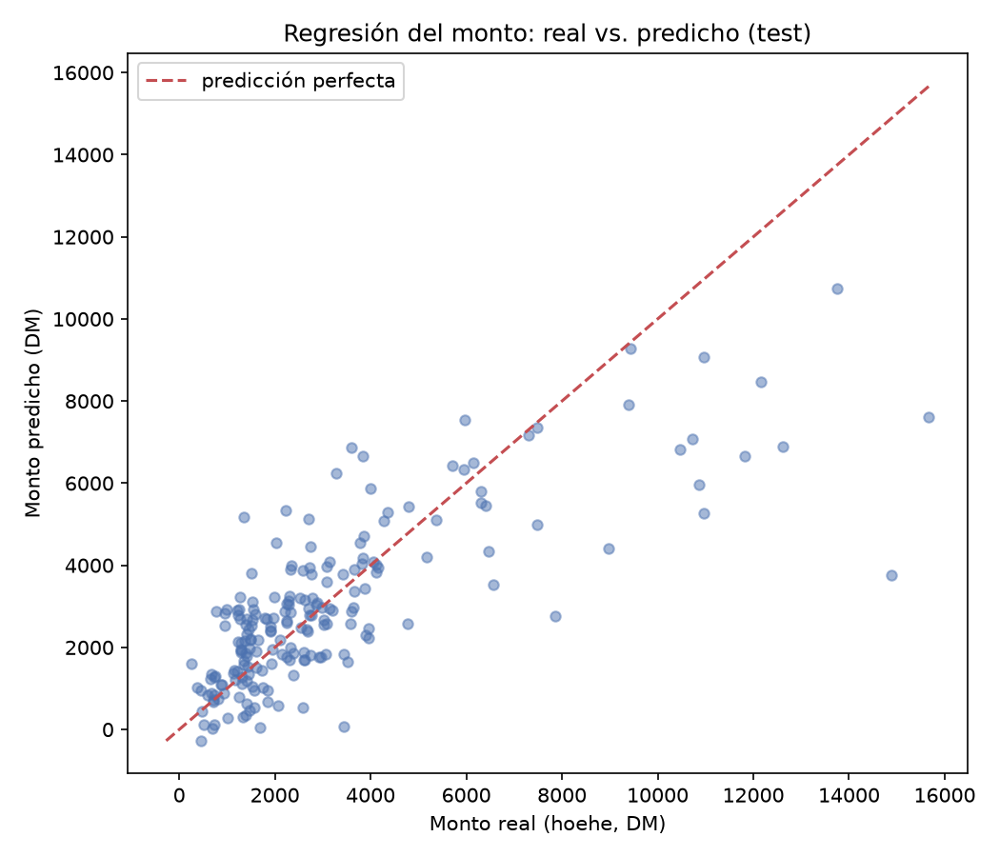

**Figura 3.** Monto real vs. predicho en prueba: la nube sigue la diagonal en la zona central y satura en los extremos. Fuente: `docs/modelos/figuras/`.

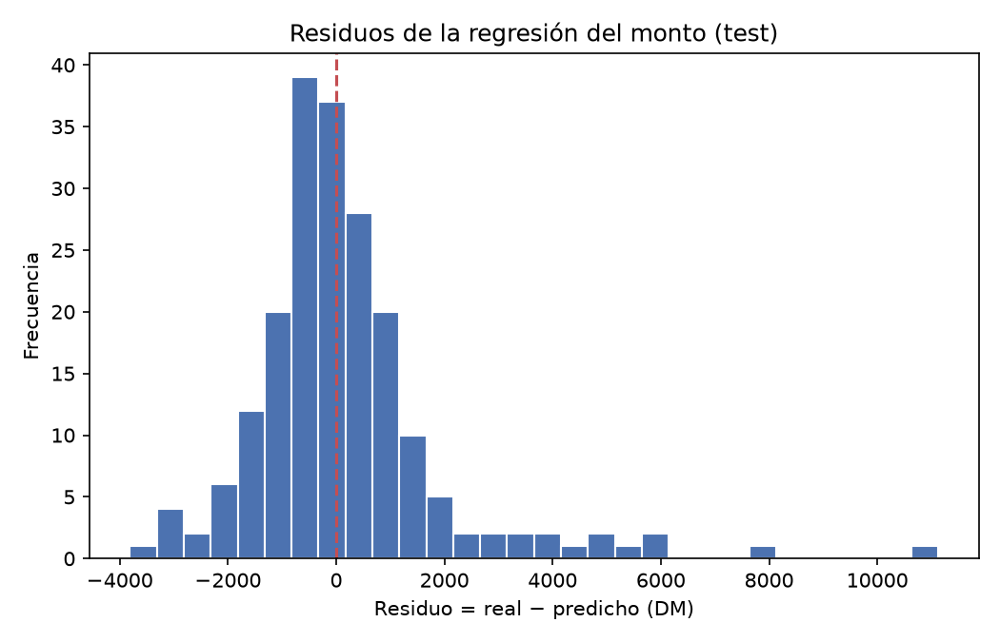

**Figura 4.** Residuos de la regresión: aproximadamente simétricos con cola derecha (subestimación de créditos grandes). Fuente: `docs/modelos/figuras/`.

### 5.3 Clasificación del riesgo

**Tabla 5.** Comparación por CV estratificada 5-fold (train)

| Modelo | ROC-AUC | F1 (bad) |
|---|---:|---:|
| **Logística balanceada C = 0.1** | **0.772 ± 0.044** | 0.779 |
| RandomForest 300 (balanceado) | 0.771 ± 0.033 | 0.805 |
| Logística balanceada C = 1.0 | 0.763 ± 0.036 | 0.767 |
| Baseline (mayoritaria) | 0.500 | —* |

\* El F1 del baseline con clase positiva = bad es 0; predice todo "good".

**Tabla 6.** Evaluación final en prueba (umbral 0.49, ajustado en train)

| Métrica | Valor | Lectura |
|---|---:|---|
| ROC-AUC | **0.835** | supera la meta (> 0.70) y al modelo manual de U2 (0.703) |
| Accuracy | 0.725 | 72.5 %: solo 2.5 pp sobre el 70 % de predecir todo "good"; métrica secundaria ligada a la prevalencia |
| Recall bad | **0.767** | detecta 46 de los 60 malos del test |
| Precisión bad | 0.529 | 47 de cada 100 alertas son falsa alarma |
| F1 (bad) | 0.626 | balance recall/precisión |

**Tabla 7.** Matriz de confusión en prueba (bad = clase positiva)

| | pred bad | pred good |
|---|---:|---:|
| **real bad** | 46 (TP) | 14 (FN) |
| **real good** | 41 (FP) | 99 (TN) |

*Nota.* `labels = [1, 0]` ⇒ primera fila/columna = bad. Lectura operativa: el modelo filtra el 77 % de los morosos potenciales a cambio de marcar para revisión el 29 % de los buenos (41/140); escapa un malo cuesta más que falsa-alarma un bueno, por lo que el punto de operación es defendible y recalibrable según la matriz de costos real.

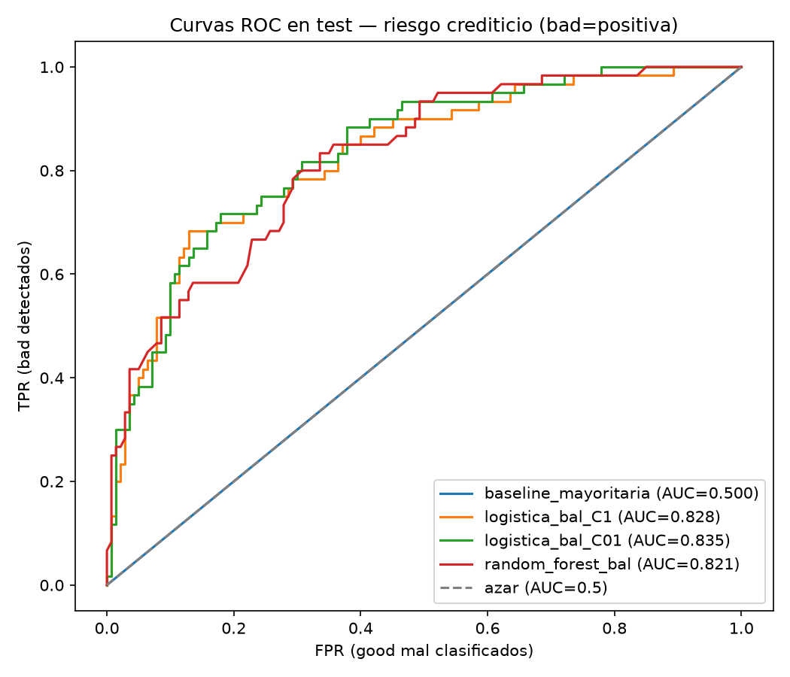

**Figura 5.** Curvas ROC en prueba: las tres curvas van pegadas (AUC 0.821–0.835); la elección del algoritmo importa menos que tener las variables correctas. Fuente: `docs/modelos/figuras/`.

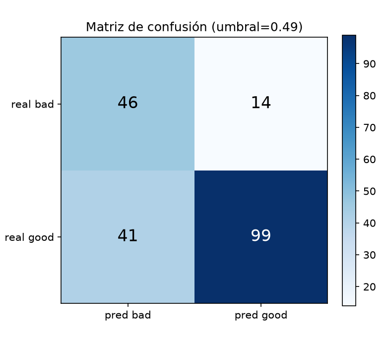

**Figura 6.** Matriz de confusión con el umbral óptimo (0.49). Fuente: `docs/modelos/figuras/`.

Las variables dominantes del clasificador son el estado de la cuenta (`laufkont_ge200_or_salary` 0.709; `laufkont_no_checking` 0.636), el propósito `car_new` (0.543), el historial (`moral_all_bank_paid` 0.518; `moral_critical` 0.333) y los ahorros desconocidos (0.466) — exactamente los gradientes de Q1 y Q3 del Data Mart.

**Caveat de reporte:** el AUC de prueba (0.835) excede al de CV (0.772 ± 0.044); la partición de prueba resultó favorable, por lo que el número conservador a reportar es el de CV.

### 5.4 Síntesis del modelado supervisado

Ambos problemas comparten el patrón "los modelos lineales bastan": las relaciones en los datos son mayormente monotónicas y aditivas, y con n = 1 000 la regularización evita el sobreajuste. La respuesta a la pregunta 1 es **sí** (AUC 0.84, recall 77 % de los malos) y a la pregunta 2 es **parcialmente** (60 % de varianza explicada, con limitación en los extremos).

---

## 6. Unidad IV — Análisis no supervisado

### 6.1 Selección de variables y estandarización

La matriz de clustering (1 000 × 71) se construyó **sin la respuesta** para evitar circularidad: se excluyen `kredit`, `kredit_cat` y `cuota_aprox_mensual`. Entran 3 numéricas (`laufzeit`, `hoehe`, `alter`) **estandarizadas** con StandardScaler y las 17 categóricas en one-hot; las dummies permiten a K-means tratar el espacio nominal sin imponer órdenes falsos entre categorías.

### 6.2 PCA

La varianza está muy repartida: PC1 explica solo el 15.0 % y se requieren **23 componentes para el 80 %** (31 para el 90 %). No existe un "eje del riesgo" único; el comportamiento es el esperado con muchas dummies casi independientes (Jolliffe & Cadima, 2016). Lo relevante es el **contenido de PC1**: loadings dominantes `hoehe` (0.674) y `laufzeit` (0.643), ambos positivos ⇒ **PC1 es el eje de exposición**.

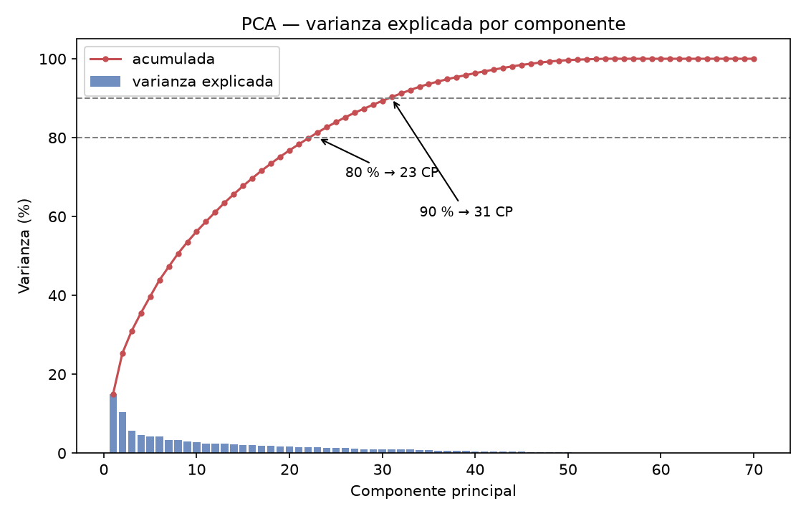

**Figura 7.** Varianza explicada por componente (scree + acumulada, con marcas de 80 % y 90 %). Fuente: `docs/modelos/figuras/`.

### 6.3 K-means y selección de k

El silhouette máximo se alcanza en **k = 2** (0.131) con caída monótona a partir de ahí; el codo de la inercia se dobla en k ≈ 2–3. Un silhouette de 0.13 es bajo en términos absolutos: en 71 dimensiones con dummies, los grupos se solapan; la partición binaria no describe "islas" sino el gradiente principal de los datos (Rousseeuw, 1987).

**Tabla 8.** Perfil de los segmentos (k = 2, silhouette 0.131)

| | Clúster 0 — exposición alta | Clúster 1 — exposición baja |
|---|---:|---:|
| Clientes | 254 (25 %) | 746 (75 %) |
| Monto medio | **6 895 DM** | 2 037 DM |
| Plazo medio | **36 meses** | 16 meses |
| % malos (real) | **43.7 %** | 25.3 % |

**Validación post-hoc (hallazgo central de la Unidad IV):** el clustering nunca vio `kredit`, y aun así sus segmentos **casi triplican** el gradiente de riesgo real (43.7 % vs. 25.3 %; base 30 %). La exposición — no la demografía — es la variable maestra. El perfil cualitativo refuerza la lectura: el segmento riesgoso sobre-representa `telef_yes` (+0.20), `beruf_high_qual_selfemp` (+0.16), `verm_real_estate` (+0.15) y `verw_car_new` (+0.13): el **cliente solvente sobreexpuesto**, no el marginal.

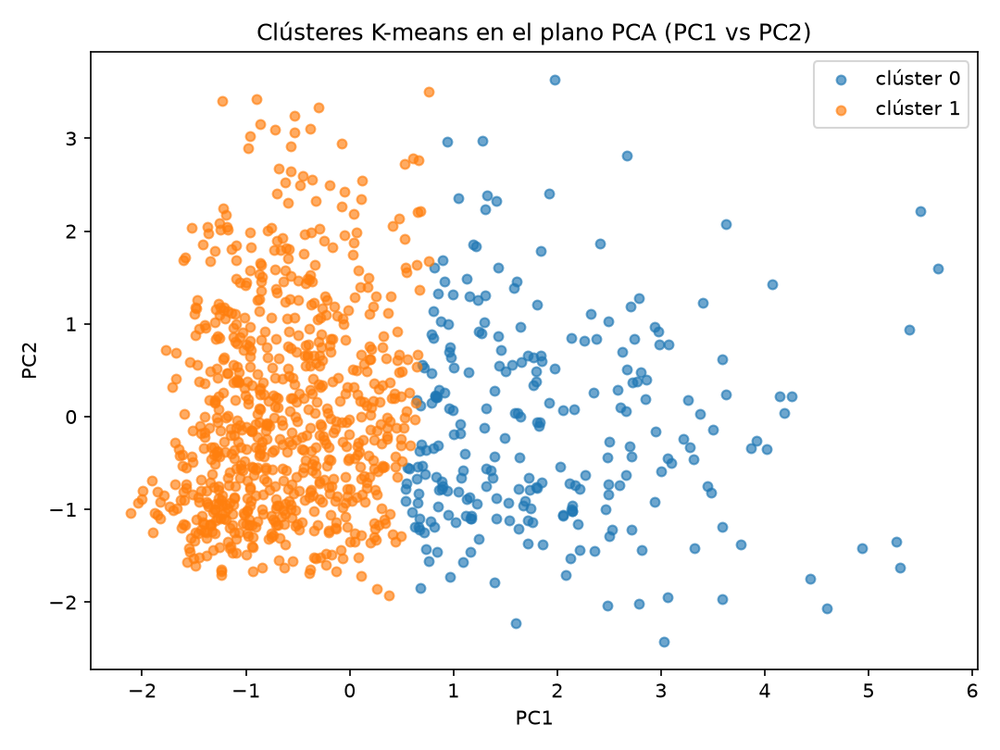

**Figura 8.** Clústeres en el plano PC1–PC2: separación por el eje exposición con solape en la frontera. Fuente: `docs/modelos/figuras/`.

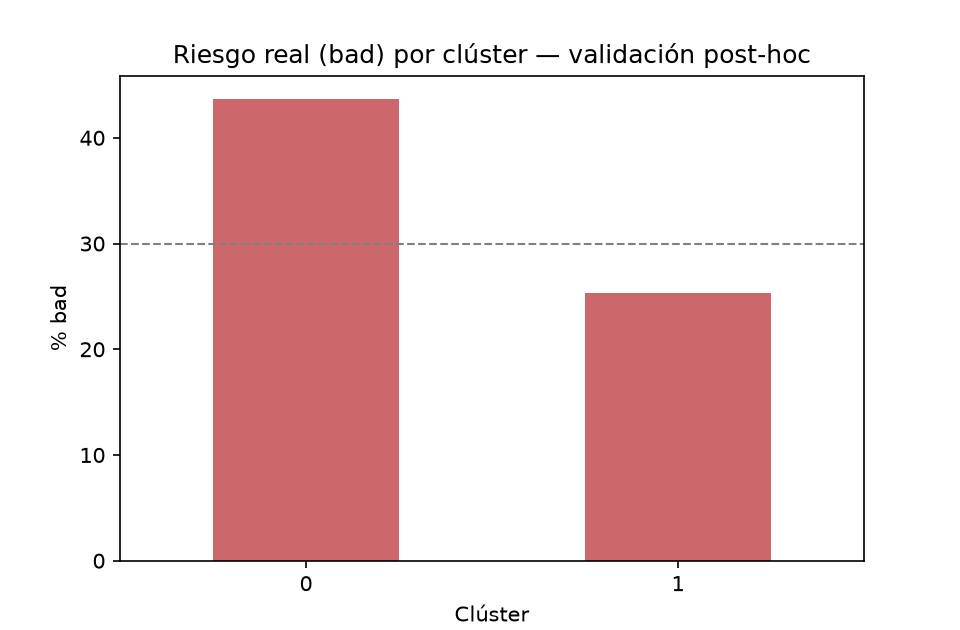

**Figura 9.** Riesgo real por segmento frente a la línea base del 30 %. Fuente: `docs/modelos/figuras/`.

La respuesta a la pregunta 3 es **sí, con matices**: existen dos segmentos defendibles y de valor de negocio (políticas diferenciadas por monto × plazo), aunque con solape, por lo que deben usarse como regímenes gerenciales y no como identificadores rígidos.

---

## 7. Dashboard y storytelling

El entregable de comunicación es un **dashboard HTML autocontenido** (`dashboard/index.html`, ≈ 377 KB): jinja2 + matplotlib con figuras en base64; se abre en cualquier navegador sin servidor ni internet. Se alimenta **en vivo** del Data Mart SQLite (KPIs y consultas Q1–Q5 re-ejecutadas en cada generación).

**Referencia de consulta completa** (estilo APA 7, recurso de software):

> Domínguez Zárate, A. (2026). *Dashboard de riesgo crediticio — South German Credit* [Dashboard HTML]. GitHub. https://github.com/Borre4023/REC_ECBD_2026_Dominguez_Zarate_Alexander/blob/main/dashboard/index.html

*Nota.* Para consultarlo localmente: `py src/dashboard/generar_dashboard.py` y abrir `dashboard/index.html`. A continuación se presentan capturas de sus secciones.

### 7.1 Panorama de la cartera

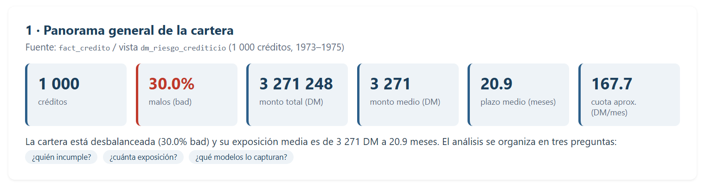

**Captura 1.** KPIs de cartera: 1 000 créditos, 30.0 % malos, 3 271 248 DM de monto total, 3 271 DM de monto medio, plazo medio 20.9 meses y cuota aproximada de 167.7 DM/mes. Los tres chips indican la estructura narrativa del dashboard: ¿quién incumple?, ¿cuánta exposición?, ¿qué modelos lo capturan?

### 7.2 ¿Quién incumple? (Q1 y Q3)

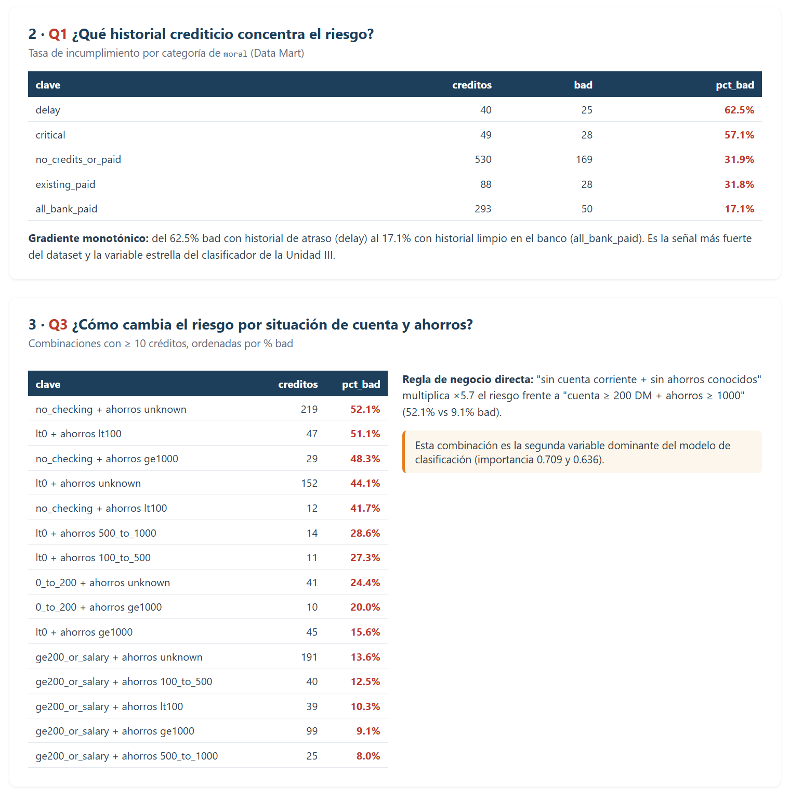

**Captura 2.** Consultas Q1 (historial) y Q3 (cuenta + ahorros). La tabla completa de combinaciones muestra el gradiente desde 52.1 % bad ("sin cuenta + sin ahorros") hasta 9.1 % ("cuenta ≥ 200 DM + ahorros ≥ 1000"), con la regla de negocio ×5.7 destacada.

### 7.3 ¿Cuánta exposición? (Q5, Q2 y Q4)

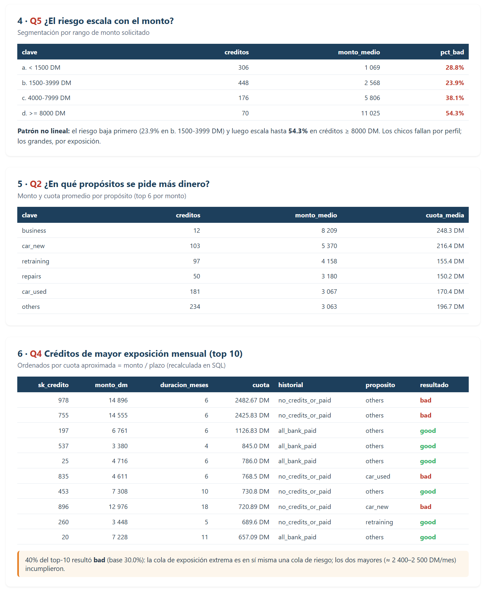

**Captura 3.** Consultas Q5 (patrón no lineal del riesgo por rango de monto, hasta 54.3 % en ≥ 8 000 DM), Q2 (propósitos ordenados por monto: `business` 8 209 DM) y Q4 (top-10 de cuota mensual con resultado coloreado: 40 % bad).

### 7.4 ¿Qué modelos lo capturan? (Unidades III y IV)

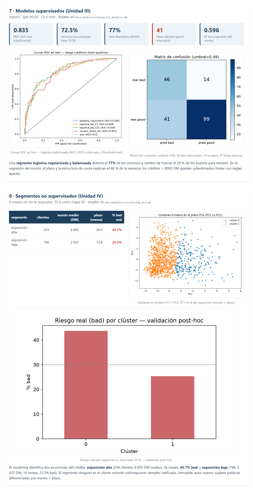

**Captura 4.** Resultados de los modelos supervisados (AUC 0.835; accuracy 72.5 %; 77 % de bads detectados; 41 falsas alarmas; R² 0.596 con figuras ROC y matriz de confusión incrustadas) y de los segmentos no supervisados (tabla de exposición alta/baja, plano PCA y validación post-hoc del % bad).

---

## 8. Discusión integrada

Los tres componentes del proyecto convergen en una misma historia, verificada por vías independientes:

1. **El historial crediticio es la señal más fuerte.** El gradiente Q1 del Data Mart (62.5 % → 17.1 %) reaparece como las importancias dominantes del clasificador (`moral` 0.518/0.333). Cuando dos vías metodológicas distintas —SQL descriptivo y aprendizaje supervisado— señalan lo mismo, el hallazgo es robusto.
2. **La exposición escala el riesgo de forma no lineal.** Q5 (54.3 % en ≥ 8 000 DM), la saturación de la regresión en montos altos y el segmento de exposición alta del clustering (43.7 % bad) describen el mismo fenómeno: el riesgo de los créditos grandes no es proporcional sino sobredimensionado.
3. **El segmento riesgoso es el cliente solvente sobreexpuesto.** Es el resultado contraintuitivo más útil del análisis: la política correcta no es vigilar a los perfiles "marginales" (que ya lo están) sino fijar límites y revisión reforzada en clientes con patrimonio documentado que piden montos grandes a plazos largos.
4. **Respuesta a las preguntas específicas.** (1) Clasificación: sí, con AUC 0.835/0.77 y detección del 77 % de los malos. (2) Regresión: sí con límites (R² 0.60, útil por rangos). (3) No supervisado: sí, dos segmentos defendibles con valor de negocio.

Estos niveles de desempeño son consistentes con lo publicado para el dataset German Credit/South German Credit, donde los clasificadores bien regularizados alcanzan típicamente AUC en el rango 0.70–0.80 (Groemping, 2019); el valor obtenido se ubica en el extremo superior de ese rango sin ingeniería de variables especial.

### 8.1 Recomendaciones de negocio

1. **Controlar la exposición, no solo el perfil.** Los tres análisis coinciden: el riesgo crece con monto × plazo. Política sugerida: revisión reforzada y garantías adicionales para créditos ≥ 8 000 DM o plazos ≥ 36 meses (Q5: 54.3 % bad; clúster alto: 43.7 %).
2. **Usar cuenta y ahorros como semáforo.** "Sin cuenta + sin ahorros" concentra 52.1 % bad frente a 9.1 % de "cuenta ≥ 200 DM + ahorros ≥ 1000" (×5.7): exigir aval o ajustar precio en el primer caso y habilitar flujo ágil en el segundo.
3. **Fijar el punto de operación con la matriz de costos.** El umbral 0.49 prioriza detectar morosos (77 %) a costa de 29 % de falsas alarmas; debe recalibrarse con el costo real de un crédito incobrable frente al de una revisión manual.
4. **Monitorear y reentrenar.** Validación *out-of-time*, vigilancia de deriva (variables de época como `telef` o `gastarb`) y revisión de equidad antes de cualquier uso real; el modelo es un apoyo analítico, no un aprobador automático.

---

## 9. Limitaciones

1. **Época:** créditos de 1973–1975 en marcos alemanes (DM); el peso de variables como `telef` o `gastarb` no es trasladable a carteras actuales sin re-entrenar.
2. **Tamaño y muestreo:** n = 1 000 con malos sobrerrepresentados (30 % vs. su frecuencia real); las métricas de precisión dependen de esa prevalencia.
3. **`hoehe` transformada:** el monto es una transformación monótona no documentada; las unidades absolutas de la regresión son orientativas.
4. **Silhouette bajo (0.131):** los clústeres se solapan; la segmentación es gerencial, no identificadoria.
5. **Sin validación temporal:** la evaluación no simula el orden de producción; un esquema *out-of-time* podría degradar las métricas.
6. **No causalidad:** los modelos capturan asociaciones; ninguna decisión de crédito real debe basarse directamente en ellos.
7. **Umbral y costos:** el punto de operación (0.49) asume costos simétricos; en producción debe calibrarse con la matriz de costos real.

---

## 10. Conclusiones

Por objetivo específico:

1. **Documentación y diagnóstico:** el dataset quedó caracterizado con diccionario v2 y un informe técnico de 10 secciones; los artefactos de codificación (invertidas, categorías vacías, mezclas) quedaron documentados como riesgo de interpretación.
2. **ETL:** la preparación se implementó como pipeline reproducible con un **contrato de calidad de 7 chequeos** (7/7 OK) y una variable derivada de carga financiera.
3. **Data Warehouse/Data Mart:** el diseño estrella se implementó y validó en SQLite (8 dimensiones, 1 000 hechos, 0 violaciones FK) con cinco consultas de negocio; el dashboard se alimenta de él.
4. **Modelado supervisado:** la clasificación del riesgo alcanzó **ROC-AUC 0.835 en prueba** (logística balanceada) detectando el 77 % de los malos; la regresión del monto explica el 60 % de su varianza y reveló el límite predictivo en los extremos.
5. **Modelado no supervisado:** PCA evidenció que la primera dimensión estructural es la **exposición**; K-means produjo dos segmentos que, sin ver la respuesta, discriminan el riesgo real (43.7 % vs. 25.3 %).
6. **Comunicación:** un dashboard autocontenido alimenta la narrativa de las tres preguntas de negocio con datos vivos del Data Mart.

**Aporte central:** la triangulación entre SQL descriptivo, aprendizaje supervisado y no supervisado —sobre un pipeline con calidad garantizada— convierte una tabla de créditos de los años 70 en una política de negocio defendible: *vigilar la exposición, no el perfil superficial*.

**Trabajo futuro:** validación temporal (out-of-time), calibración del umbral por matriz de costos, ingeniería de interacciones (cuenta × historial), alternativas de clustering para datos mixtos (GMM, K-prototypes) y despliegue del modelo como servicio con monitoreo de deriva.

---

## Referencias

Fayyad, U., Piatetsky-Shapiro, G., & Smyth, P. (1996). From data mining to knowledge discovery in databases. *AI Magazine, 17*(3), 37–54. https://doi.org/10.1609/aimag.v17i3.1230

Groemping, U. (2019). *South German Credit data: Correcting the coding of the "Statlog German Credit" data* (Reports in Mathematics, Statistics and Operations Research, Report 1/2019). Beuth University of Applied Sciences Berlin.

Han, J., Kamber, M., & Pei, J. (2012). *Data mining: Concepts and techniques* (3.ª ed.). Morgan Kaufmann.

Harris, C. R., Millman, K. J., van der Walt, S. J., et al. (2020). Array programming with NumPy. *Nature, 585*, 357–362. https://doi.org/10.1038/s41586-020-2649-2

James, G., Witten, D., Hastie, T., & Tibshirani, R. (2021). *An introduction to statistical learning: With applications in Python*. Springer. https://doi.org/10.1007/978-1-0716-1418-1

Jolliffe, I. T., & Cadima, J. (2016). Principal component analysis: A review and recent developments. *Philosophical Transactions of the Royal Society A, 374*(2065), 20150202. https://doi.org/10.1098/rsta.2015.0202

Kimball, R., & Ross, M. (2013). *The data warehouse toolkit: The definitive guide to dimensional modeling* (3.ª ed.). Wiley.

Pedregosa, F., Varoquaux, G., Gramfort, A., et al. (2011). Scikit-learn: Machine learning in Python. *Journal of Machine Learning Research, 12*, 2825–2830.

Rousseeuw, P. J. (1987). Silhouettes: A graphical aid to the interpretation and validation of cluster analysis. *Journal of Computational and Applied Mathematics, 20*, 53–65. https://doi.org/10.1016/0377-0427(87)90125-7

*South German Credit* [Dataset]. (2020). UCI Machine Learning Repository. https://doi.org/10.24432/C5QG88

Wirth, R., & Hipp, J. (2000). CRISP-DM: Towards a standard process model for data mining. *Proceedings of the 4th International Conference on the Practical Applications of Knowledge Discovery and Data Mining (PADD 2000)*, 29–39.

---

## Anexos

### Anexo A. Reproducibilidad completa

```bash
# 1) ETL: dataset procesado + reporte de calidad (7/7 chequeos OK)
py src/etl/etl_south_german_credit.py
# 2) Data Mart SQLite (0 violaciones FK)
py src/etl/build_dw_sqlite.py
# 3) Modelos supervisados (pkl + metricas.json + figuras)
py src/models/entrenar_regresion.py          # RidgeCV, R2 test 0.596
py src/models/entrenar_clasificacion.py      # logistica balanceada, AUC 0.835
# 4) Unidad IV: PCA + K-means (k=2)
py src/models/clustering_pca.py
# 5) Diagrama del Data Mart
py src/etl/diagrama_dw.py
# 6) Dashboard autocontenido
py src/dashboard/generar_dashboard.py
```

Versión didáctica paso a paso: notebooks `01`–`05` en `notebooks/` (ejecutados secuencialmente, 0 errores).

### Anexo B. Estructura del repositorio

```text
├── README.md
├── data/            raw/ (original, inmutable) · processed/ (generado)
├── notebooks/       01_exploracion · 02_preparacion_etl · 03_regresion · 04_clasificacion · 05_clustering_pca
├── src/             etl/ · preprocessing/ · models/ · dashboard/
├── sql/             schema_dw.sql (PostgreSQL) · schema_dw_sqlite.sql · queries_dm.sql
├── modelos/         regresion/ · clasificacion/ · clustering/ (.pkl + metricas.json)
├── dashboard/       index.html (autocontenido)
└── docs/            planeacion/ · diccionario_datos/ · analisis/ · modelos/ · resultados/
```

### Anexo C. Tabla de entregables por unidad

| Unidad / requisito | Entregable(s) |
|---|---|
| Diagnóstico y limpieza (U2) | `docs/analisis/exploracion_tecnica.md` (+ `.html`), `exploracion_tecnica.py` |
| Diccionario de datos | `docs/diccionario_datos/diccionario_datos_v2.md` (v1 respaldado) |
| ETL y dataset procesado | `src/etl/etl_south_german_credit.py`, `data/processed/` |
| Data Mart y SQL | `sql/schema_dw_sqlite.sql`, `sql/queries_dm.sql`, `build_dw_sqlite.py`, diagrama (Figura 2) |
| Modelos (U3) | `src/models/entrenar_regresion.py`, `entrenar_clasificacion.py`, `docs/modelos/evaluacion_modelos.md` |
| No supervisado (U4) | `src/models/clustering_pca.py`, `docs/modelos/clustering_pca.md` |
| Dashboard | `dashboard/index.html` + `src/dashboard/` |
| Bitácora | `docs/Informe de cambios (actualiza esta cosa cada cambio).md` |
| Informe final | `docs/resultados/informe_final_borrador.md` (+ `.html`) |

### Anexo D. Métricas finales consolidadas

| Modelo | Métrica | Valor |
|---|---|---:|
| Clasificación (logística C=0.1) | ROC-AUC (CV / test) | 0.772 / **0.835** |
| | Recall bad / Precisión bad | 0.767 / 0.529 |
| | Accuracy | 0.725 |
| | Matriz (TP, FN, FP, TN) | 46, 14, 41, 99 |
| Regresión (RidgeCV α=31.62) | R² (CV / test) | 0.550 / **0.596** |
| | RMSE / MAE (DM) | 1 798 / 1 139 |
| Clustering (K-means k=2) | Silhouette | 0.131 |
| | % bad por segmento | 43.7 / 25.3 |
| PCA | Varianza PC1 / CP para 80 % | 15.0 % / 23 |
